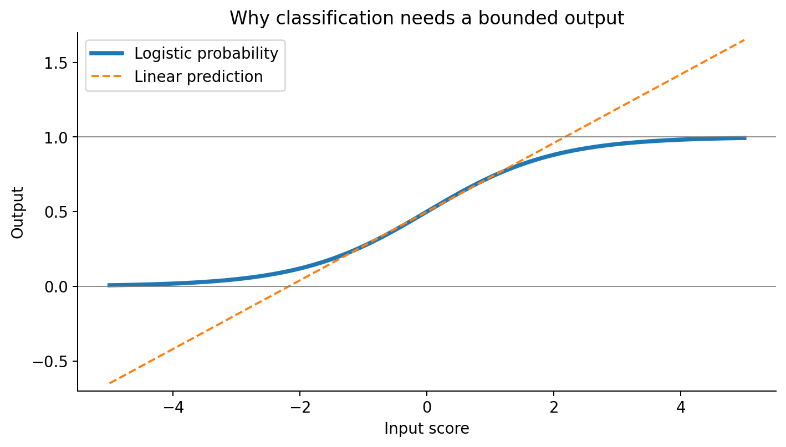
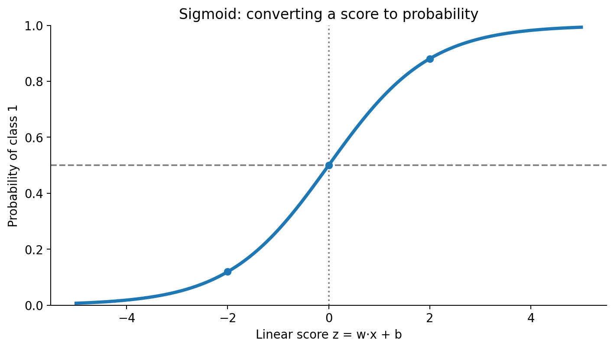
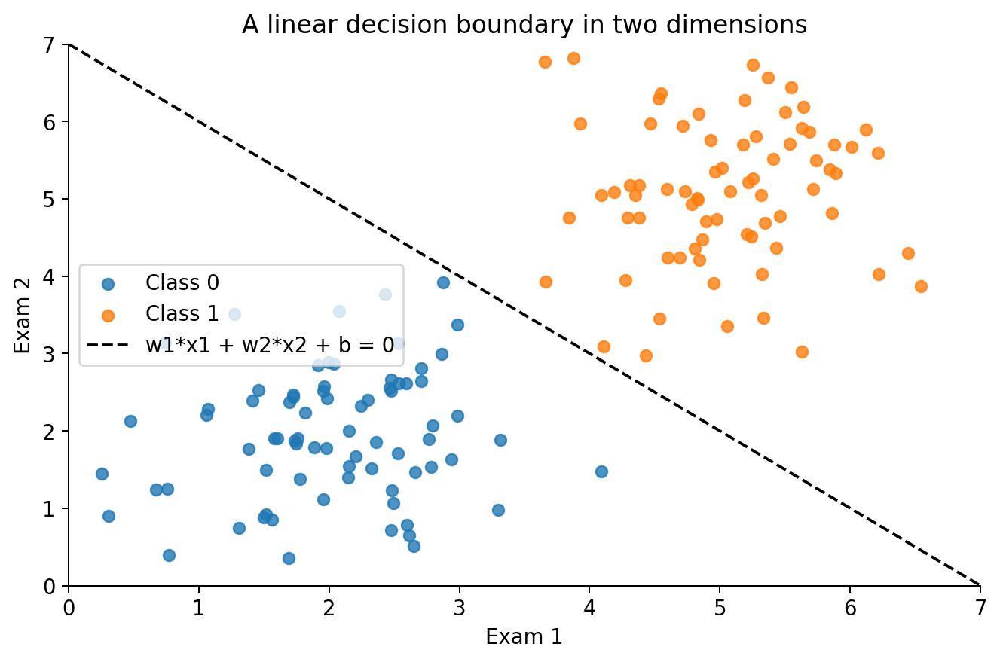
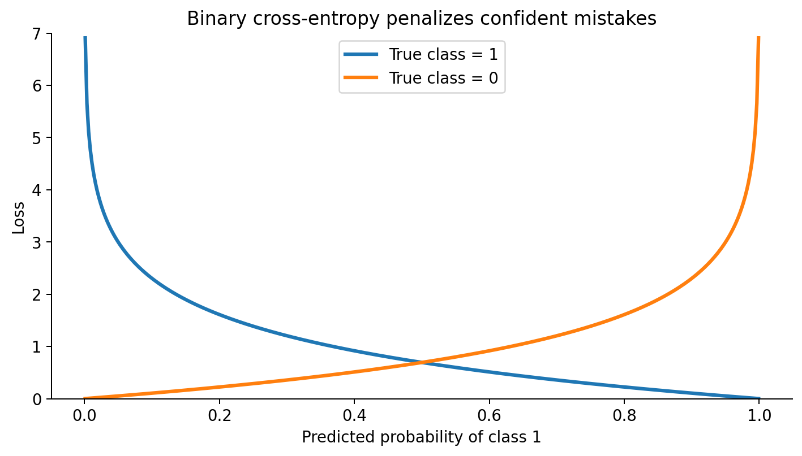
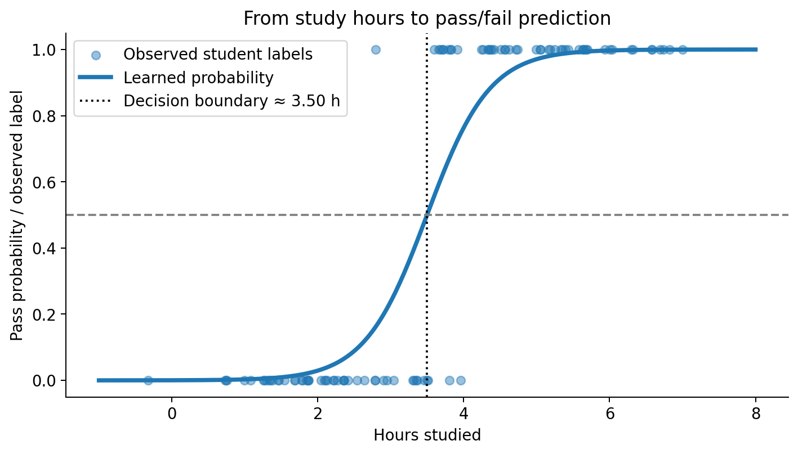
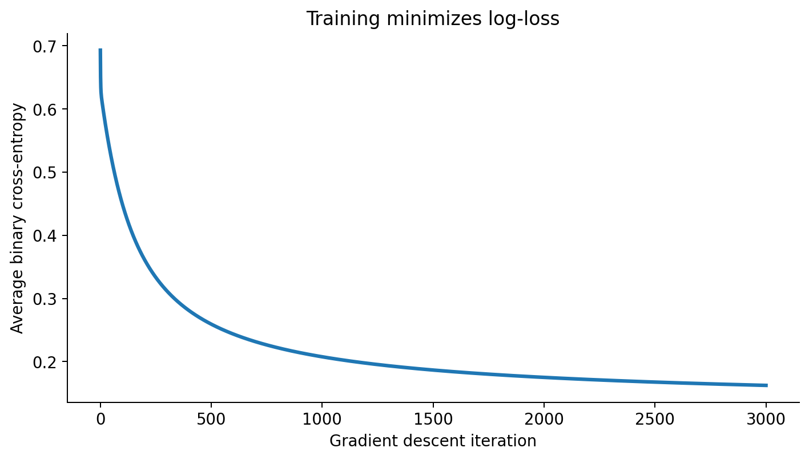
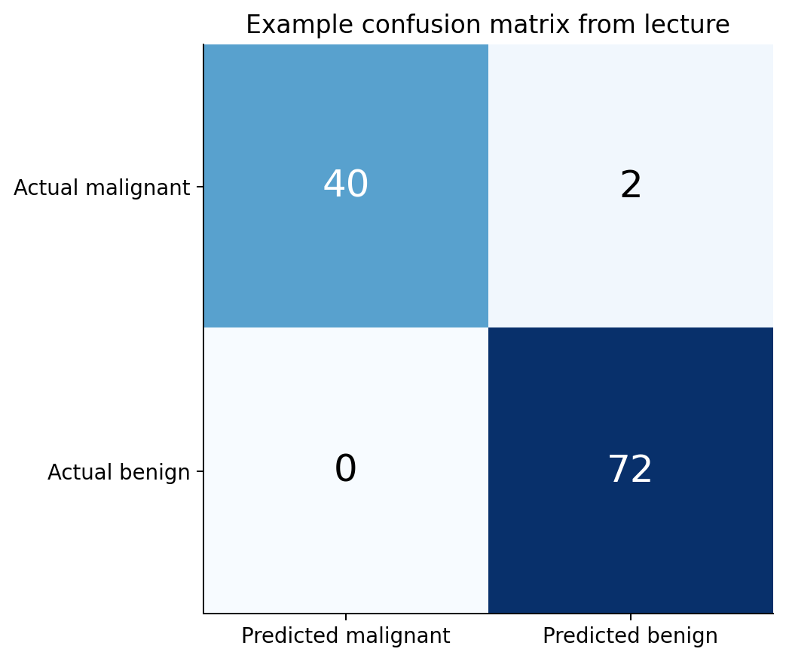

# Logistic Regression — From Linear Scores to Classification

> A visual, code-first guide to the **Logistic Regression** lecture, presented by **TriNode Team**. The examples and topic order follow the lecture; additional explanations and diagrams are provided to make the ideas easier to understand.

## Contents
1. [What is classification?](#1-what-is-classification)
2. [Why not linear regression?](#2-why-not-linear-regression)
3. [How logistic regression works](#3-how-logistic-regression-works)
4. [The sigmoid function](#4-the-sigmoid-function)
5. [Odds, log-odds, and coefficients](#5-odds-log-odds-and-coefficients)
6. [Decision boundaries](#6-decision-boundaries)
7. [Log-loss and gradient descent](#7-log-loss-and-gradient-descent)
8. [Training from scratch](#8-training-from-scratch)
9. [Multiclass classification and softmax](#9-multiclass-classification-and-softmax)
10. [Evaluation metrics](#10-evaluation-metrics)
11. [Real-world scikit-learn example](#11-real-world-scikit-learn-example)
12. [Thresholds, ROC, and AUC](#12-thresholds-roc-and-auc)
13. [Regularization](#13-regularization)
14. [Linear vs. logistic regression](#14-linear-vs-logistic-regression)
15. [Quick recap](#15-quick-recap)

## 1. What is classification?

**Classification** predicts a discrete category rather than a continuous number. In **binary classification**, the target has two possible values, typically `0` and `1`: spam/not spam, pass/fail, or benign/malignant. **Multiclass classification** selects one of three or more classes (such as an Iris species). **Multilabel classification** allows multiple labels for one observation (for example, *beach* and *sunset* in the same image).

Logistic regression directly handles binary classification. Extensions such as one-vs-rest and multinomial logistic regression handle multiclass problems. Multilabel tasks can be approached using a separate binary classifier per label.

## 2. Why not linear regression?

Linear regression predicts `y_hat = w·x + b`. This output can be any real number, including `-0.3` or `1.4`, so it cannot always represent a probability. Extreme observations can also move a fitted regression line and its implied classification cutoff. Logistic regression instead converts a linear score into a value strictly between 0 and 1.



**Interpretation:** the dashed straight line leaves the valid probability interval; the sigmoid curve stays inside it.

## 3. How logistic regression works

The model has three stages:

1. **Compute a linear score:** `z = w1*x1 + w2*x2 + ... + wn*xn + b = w·x + b`.
2. **Apply the sigmoid:** `p = sigmoid(z) = 1 / (1 + exp(-z))`, interpreted as the estimated probability of class `1`.
3. **Apply a decision threshold:** predict `1` when `p >= 0.5`, otherwise `0`. The threshold is configurable.

Here, `x` is the feature vector, `w` is the learned weight vector, and `b` is the learned bias. For example, `z = 2` gives `p ≈ 0.881`, so the prediction is class `1` at a threshold of `0.5`.

## 4. The sigmoid function



The sigmoid `σ(z) = 1/(1+e^(-z))` has useful properties:

- `σ(0) = 0.5`; positive scores produce probabilities above `0.5`.
- Very large positive scores approach `1`; very negative scores approach `0`.
- `σ(-z) = 1 - σ(z)`.
- Its derivative is `σ'(z) = σ(z)(1 - σ(z))`.

```python
import numpy as np

def sigmoid(z):
    return 1 / (1 + np.exp(-z))

for z in [-5, -2, 0, 2, 5]:
    print(f"z={z:>2}: probability={sigmoid(z):.3f}")
```

Expected values: `0.007, 0.119, 0.500, 0.881, 0.993`.

## 5. Odds, log-odds, and coefficients

**Odds** are `p / (1-p)`. If `p = 0.8`, the odds are `4`, or **4 to 1** in favor of class `1`. The **log-odds** (also called the *logit*) are linear:

`log(p / (1-p)) = w·x + b`

For a coefficient `wj`, increasing feature `xj` by one unit while holding the other features constant adds `wj` to the log-odds and multiplies the odds by `exp(wj)`. For example, `wj = 0.7` gives an odds multiplier of `exp(0.7) ≈ 2.01`. Positive coefficients increase the odds of class `1`; negative coefficients decrease them. **This is an odds change, not a fixed probability increase.**

## 6. Decision boundaries

At the default threshold, `p = 0.5` exactly when `z = 0`. Thus, the decision boundary is:

`w1*x1 + w2*x2 + b = 0`

With two features, this is a straight line. With three features, it is a plane. The sigmoid is nonlinear in the score, but the boundary is **linear in the original features**. Adding polynomial features can produce curved boundaries in the original input space.



For two features, solve for the second coordinate: `x2 = -(w1*x1 + b)/w2`, provided `w2 != 0`.

```python
import numpy as np
import matplotlib.pyplot as plt
from sklearn.linear_model import LogisticRegression

# X has two columns: [exam_1, exam_2]; y contains binary admission labels.
# Supply your own X and y before running this snippet.
clf = LogisticRegression().fit(X, y)
w = clf.coef_[0]
b = clf.intercept_[0]
x1 = np.linspace(X[:, 0].min(), X[:, 0].max(), 100)
if abs(w[1]) > 1e-12:
    x2 = -(w[0] * x1 + b) / w[1]
    plt.scatter(X[:, 0], X[:, 1], c=y, cmap="coolwarm")
    plt.plot(x1, x2, "k--", label="p = 0.5 boundary")
    plt.legend()
    plt.show()
```

## 7. Log-loss and gradient descent

### Why not mean squared error?

For a sigmoid model, MSE generally produces a **non-convex objective in the model parameters**, making optimization less straightforward. It also does not punish confidently incorrect probabilities as strongly as cross-entropy. The standard logistic-regression objective is **binary cross-entropy**, also called **log-loss**:

`J(w,b) = -(1/n) * Σ [ yi*log(pi) + (1-yi)*log(1-pi) ]`

- When `y = 1`, the per-example loss is `-log(p)`.
- When `y = 0`, it is `-log(1-p)`.
- A correct, confident prediction has near-zero loss; a confident mistake has very large loss.
- Predicting `0.5` for every observation yields `log(2) ≈ 0.693`.



Minimizing unregularized log-loss corresponds to **maximum likelihood estimation** for Bernoulli outcomes. Unlike MSE with a sigmoid, unregularized binary logistic cross-entropy is convex in `w` and `b` (though a unique finite optimum is not guaranteed for perfectly separable data).

### Gradient descent

The gradients are:

`dJ/dw = (1/n) * X.T @ (p - y)`

`dJ/db = mean(p - y)`

Update the parameters repeatedly using `w = w - learning_rate * dJ/dw` and `b = b - learning_rate * dJ/db`. Here `p` is the vector of predicted class-1 probabilities. There is no ordinary least-squares-style normal equation for logistic regression; numerical optimization is used.

## 8. Training from scratch

This example follows the lecture: 50 students who failed, 50 who passed, and **hours studied** as the only feature.

```python
import numpy as np
import matplotlib.pyplot as plt

rng = np.random.default_rng(0)
X = np.r_[rng.normal(2, 1, 50), rng.normal(5, 1, 50)]
y = np.r_[np.zeros(50), np.ones(50)]

w, b, lr = 0.0, 0.0, 0.1
losses = []

for epoch in range(3001):
    p = 1 / (1 + np.exp(-(w * X + b)))
    p_safe = np.clip(p, 1e-12, 1 - 1e-12)
    loss = -np.mean(y * np.log(p_safe) + (1 - y) * np.log(1 - p_safe))
    losses.append(loss)

    dw = np.mean((p - y) * X)
    db = np.mean(p - y)
    w -= lr * dw
    b -= lr * db

print(f"Learned weight: {w:.3f}")
print(f"Learned bias: {b:.3f}")
print(f"Boundary: {-b/w:.2f} study hours")

xs = np.linspace(-1, 8, 200)
probs = 1 / (1 + np.exp(-(w * xs + b)))
plt.scatter(X, y, alpha=0.4, label="Students")
plt.plot(xs, probs, color="red", label="Predicted P(pass)")
plt.axhline(0.5, color="gray", linestyle="--")
plt.axvline(-b / w, color="black", linestyle=":")
plt.xlabel("Hours studied")
plt.ylabel("Probability / class")
plt.legend()
plt.show()

plt.plot(losses)
plt.xlabel("Epoch")
plt.ylabel("Log-loss")
plt.show()
```



**Read the plot:** the dots are the observed pass/fail outcomes, the S-curve is the learned probability, and the vertical dotted line marks the approximately **3.5-hour** `p=0.5` cutoff for this simulated dataset.



**Read the plot:** gradient descent adjusts `w` and `b` so the average cross-entropy decreases.

## 9. Multiclass classification and softmax

Two common extensions are:

- **One-vs-Rest (OvR):** fit one binary classifier per class, then select the class with the highest score. The individual binary probabilities need not sum to one.
- **Multinomial (softmax) logistic regression:** learn scores for all classes jointly and normalize them into probabilities that sum to one.

For class `k`, **softmax** is `P(y=k|x) = exp(zk) / Σj exp(zj)`. Subtracting the largest score before exponentiating avoids numerical overflow.


```python
import numpy as np

def softmax(scores):
    scores = np.asarray(scores, dtype=float)
    exp_scores = np.exp(scores - scores.max())
    return exp_scores / exp_scores.sum()

scores = np.array([2.0, 1.0, 0.1])
probs = softmax(scores)
print(probs.round(3))  # [0.659 0.242 0.099]
print(probs.argmax())  # 0
print(-np.log(probs[0]))  # Cross-entropy if class 0 is correct
```

For multinomial classification, cross-entropy for one example is `-log(probability assigned to the true class)`.

### Iris example

```python
import numpy as np
import matplotlib.pyplot as plt
from sklearn.datasets import load_iris
from sklearn.linear_model import LogisticRegression

X, y = load_iris(return_X_y=True)
X = X[:, 2:]  # Petal length and petal width
clf = LogisticRegression(max_iter=1000).fit(X, y)
a, b = np.meshgrid(np.linspace(0.5, 7.5, 300),
                   np.linspace(0, 2.8, 300))
regions = clf.predict(np.c_[a.ravel(), b.ravel()]).reshape(a.shape)
plt.contourf(a, b, regions, alpha=0.3)
plt.scatter(X[:, 0], X[:, 1], c=y, edgecolors="k")
plt.xlabel("Petal length")
plt.ylabel("Petal width")
plt.show()
```

Each background region corresponds to a predicted Iris species; boundaries between regions are straight lines.

## 10. Evaluation metrics

A **confusion matrix** compares actual and predicted classes. The lecture's breast-cancer example uses scikit-learn labels `0 = malignant` and `1 = benign`; the displayed matrix therefore lists malignant first.



For any chosen **positive class**, define:

| Term | Meaning |
| --- | --- |
| TP | Actual positive, predicted positive |
| TN | Actual negative, predicted negative |
| FP | Actual negative, predicted positive (false alarm) |
| FN | Actual positive, predicted negative (miss) |

| Metric | Formula | What it answers |
| --- | --- | --- |
| Accuracy | `(TP + TN) / total` | What fraction of all predictions are correct? |
| Precision | `TP / (TP + FP)` | How many predicted positives are truly positive? |
| Recall / Sensitivity | `TP / (TP + FN)` | How many actual positives did we detect? |
| F1 | `2 * precision * recall / (precision + recall)` | How well do precision and recall balance? |
| Log-loss | Binary cross-entropy | How good are the predicted probabilities? |

**Important:** always state which class is positive before interpreting precision and recall. Accuracy can be misleading for imbalanced datasets. For cancer screening, missing a malignant case may be more serious than a false alarm.

## 11. Real-world scikit-learn example

The lecture uses the **Breast Cancer Wisconsin** dataset bundled with scikit-learn: **569 samples** and **30 input features**. Scaling and classification are combined in a pipeline to avoid learning the scaling parameters from the test set.

```python
from sklearn.datasets import load_breast_cancer
from sklearn.model_selection import train_test_split
from sklearn.preprocessing import StandardScaler
from sklearn.pipeline import make_pipeline
from sklearn.linear_model import LogisticRegression
from sklearn.metrics import confusion_matrix, classification_report, log_loss

X, y = load_breast_cancer(return_X_y=True)
# Dataset coding: 0 = malignant; 1 = benign.
X_train, X_test, y_train, y_test = train_test_split(
    X, y, test_size=0.2, stratify=y, random_state=0
)
model = make_pipeline(StandardScaler(), LogisticRegression(max_iter=1000))
model.fit(X_train, y_train)

pred = model.predict(X_test)
proba = model.predict_proba(X_test)
print("Accuracy:", model.score(X_test, y_test))
print("Class order:", model.classes_)
print("First probabilities:", proba[:3])
print("Confusion matrix:\n", confusion_matrix(y_test, pred))
print(classification_report(y_test, pred, target_names=["malignant", "benign"]))
print("Log-loss:", log_loss(y_test, proba))
```

**Lecture result:** approximately **98.2% test accuracy** and a confusion matrix of `[[40, 2], [0, 72]]` (rows = true class, columns = predicted class). Results can vary if preprocessing, versions, or settings change. `predict_proba` columns follow `model.classes_`: here `[P(malignant), P(benign)]`.

## 12. Thresholds, ROC, and AUC

A threshold of `0.5` is conventional, **not mandatory**. Lowering a threshold generally increases recall while increasing false positives; raising it generally reduces false positives while risking more missed positives. Precision often improves with a higher threshold, but it is **not guaranteed to increase monotonically** for every dataset.

The lecture treats **malignant** as the positive class for the following curves, so we explicitly extract its probability from column `0`:

```python
import matplotlib.pyplot as plt
from sklearn.metrics import precision_recall_curve, roc_curve, roc_auc_score

p_malignant = model.predict_proba(X_test)[:, 0]
y_malignant = (y_test == 0).astype(int)

precision, recall, thresholds = precision_recall_curve(y_malignant, p_malignant)
plt.plot(thresholds, precision[:-1], label="Precision")
plt.plot(thresholds, recall[:-1], label="Recall")
plt.xlabel("Probability threshold for malignant")
plt.legend()
plt.show()

fpr, tpr, _ = roc_curve(y_malignant, p_malignant)
auc = roc_auc_score(y_malignant, p_malignant)
plt.plot(fpr, tpr, label=f"ROC AUC = {auc:.3f}")
plt.plot([0, 1], [0, 1], "k--", label="Random baseline")
plt.xlabel("False positive rate")
plt.ylabel("True positive rate (recall)")
plt.legend()
plt.show()
```

An **ROC curve** plots `TPR = TP/(TP+FN)` against `FPR = FP/(FP+TN)` over thresholds. **AUC** summarizes the model's ranking ability: `1.0` is perfect ranking; `0.5` corresponds to random-level discrimination. AUC is threshold-independent but does not by itself describe calibration or a chosen operating point.

## 13. Regularization

Regularization discourages overly large coefficients and helps control overfitting. scikit-learn's `LogisticRegression` uses **L2 regularization by default**. The parameter `C` controls its inverse strength:

- **Small `C`** → stronger regularization → coefficients are pushed toward zero.
- **Large `C`** → weaker regularization → more flexibility.
- **L1 regularization** can drive some coefficients exactly to zero; compatible solvers include `liblinear` and `saga`.

Conceptually, the objective is `log-loss + regularization_strength * penalty(weights)`; the exact numerical scaling depends on the solver's convention.

```python
from sklearn.linear_model import LogisticRegression
from sklearn.model_selection import GridSearchCV
from sklearn.pipeline import make_pipeline
from sklearn.preprocessing import StandardScaler

pipe = make_pipeline(StandardScaler(), LogisticRegression(max_iter=1000))
search = GridSearchCV(
    pipe,
    {"logisticregression__C": [0.01, 0.1, 1, 10, 100]},
    cv=5,
    scoring="f1_macro"
)
search.fit(X_train, y_train)
print("Best C:", search.best_params_)
print("CV F1-macro:", search.best_score_)
```

## 14. Linear vs. logistic regression

| Aspect | Linear Regression | Logistic Regression |
| --- | --- | --- |
| Task | Predict a continuous value | Predict a class probability / label |
| Core model | `w·x + b` | `sigmoid(w·x + b)` |
| Output range | Any real number | Between 0 and 1 for binary class 1 |
| Typical loss | Mean squared error | Binary cross-entropy |
| Training | Closed-form least squares or iterative optimization | Iterative numerical optimization |
| Metrics | MAE, RMSE, R² | Accuracy, precision, recall, F1, log-loss, ROC AUC |

Both use a linear combination of input features, but they solve different prediction tasks.

## 15. Quick recap

**Pipeline:** `features → linear score → sigmoid → probability → threshold → predicted class`.

**Training:** choose `w` and `b` to minimize log-loss; gradient descent is one way to do it.

**Geometry:** the default decision boundary is `w·x + b = 0`.

**Extensions:** use OvR or softmax for multiclass classification.

**Evaluation:** use a confusion matrix and class-aware metrics; choose thresholds based on the cost of errors; use ROC AUC to examine ranking across thresholds.

**Practical tip:** standardize numerical features, evaluate on held-out data, and tune regularization using cross-validation.

---

### Requirements

```bash
pip install numpy matplotlib scikit-learn
```

### Image assets

All figures are stored in [`images/`](images/) and referenced using **relative Markdown paths** so they display correctly on GitHub when the repository preserves this folder structure.

### Attribution

**Lecture:** *Logistic Regression*, presented by **TriNode Team** (33-slide PDF supplied for this guide). The diagrams in this README are newly generated educational illustrations; the example confusion-matrix counts are reproduced from the lecture.
