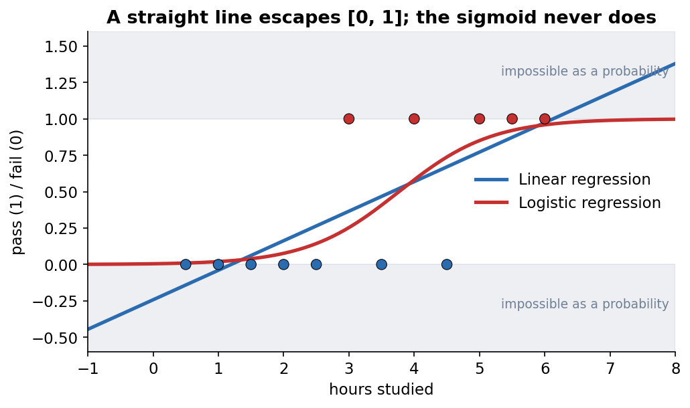
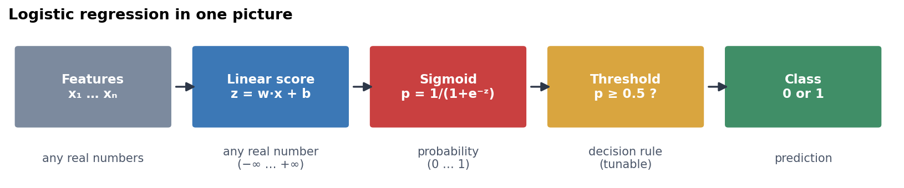
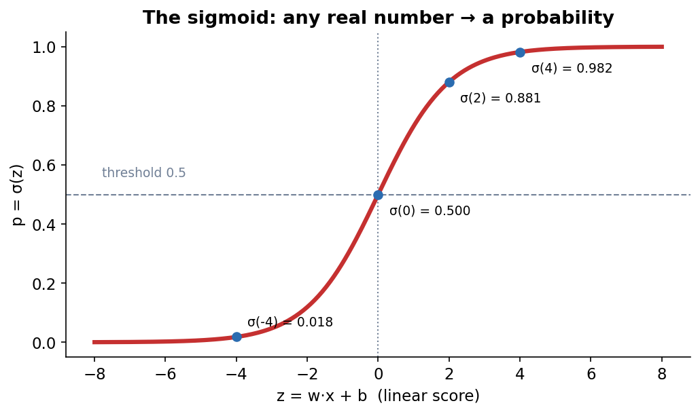
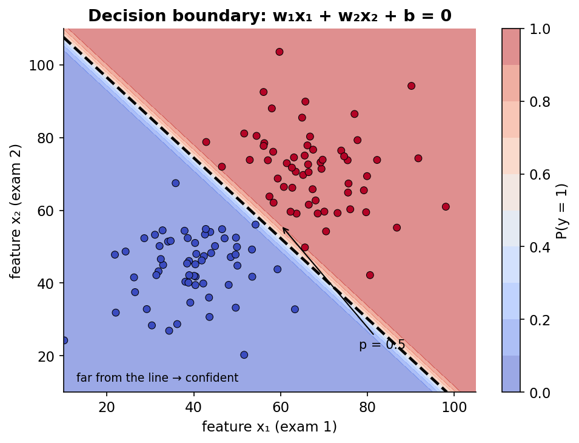
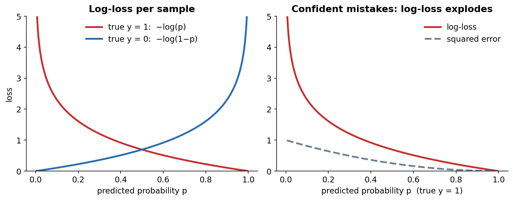
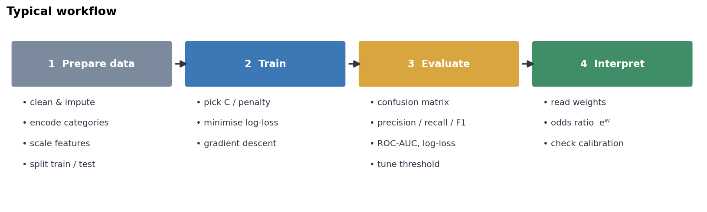
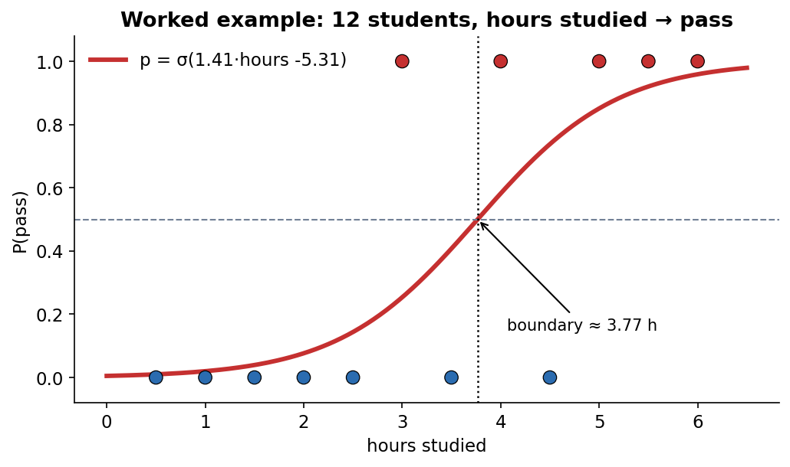
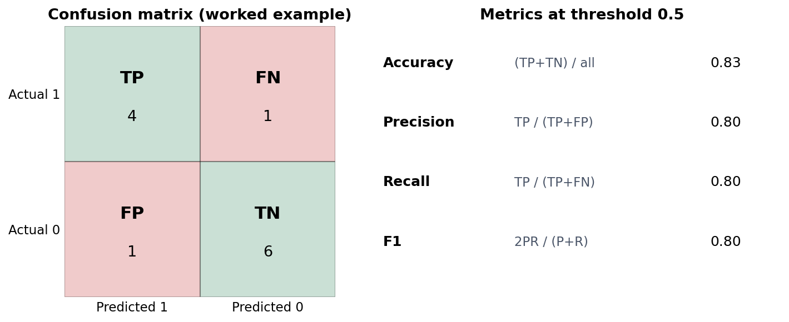

# Logistic Regression — Lecture Companion

A concise, hands-on guide to **logistic regression**, written to accompany the *Logistic Regression* lecture (TriNode Team). It explains the intuition, the key equations, a step-by-step workflow, and a small worked example you can reproduce in a minute.

> **Audience:** beginner → intermediate. You should know basic Python/NumPy and the idea of linear regression.
> **Datasets:** a hand-made 12-student "hours studied → pass" table (`data/hours_studied.csv`) for the worked example, plus scikit-learn's built-in *breast cancer* dataset for a realistic workflow.

## Contents

1. [What is logistic regression?](#1-what-is-logistic-regression)
2. [Key equations](#2-key-equations)
3. [Assumptions, pros/cons, use cases](#3-assumptions-proscons-use-cases)
4. [Step-by-step workflow](#4-step-by-step-workflow)
5. [Worked example (12 students)](#5-worked-example-12-students)
6. [Common pitfalls & tips](#6-common-pitfalls--tips)
7. [Repository structure & quick start](#7-repository-structure--quick-start)
8. [Glossary & cheat sheet](#8-glossary--cheat-sheet)

---

## 1. What is logistic regression?

Despite the name, logistic regression is a **classification** model. It predicts the probability that a sample belongs to class 1 (pass, spam, malignant…) and then turns that probability into a class.

**Why not just use linear regression?** A straight line happily predicts values below 0 or above 1, which are not valid probabilities, and a few extreme points can drag the line and shift the decision point. We need an output that always stays in $(0, 1)$.


*Figure 1 — The straight line leaves the 0–1 range; the S-shaped logistic curve never does.*

**The idea in three steps**

1. Compute a linear score, exactly like linear regression: $z = \mathbf{w}\cdot\mathbf{x} + b$ (any real number).
2. Squash it with the **sigmoid** to get a probability: $p = \sigma(z)$.
3. **Decide:** predict class 1 if $p \ge 0.5$, otherwise class 0 (the threshold can be changed).


*Figure 2 — From features to a class: linear score → sigmoid → threshold.*

The model therefore gives you **both** a probability (how sure) and a class (the decision).

---

## 2. Key equations

### 2.1 The logistic (sigmoid) function

$$\sigma(z) = \frac{1}{1+e^{-z}}, \qquad p = P(y=1\mid \mathbf{x}) = \sigma(\mathbf{w}\cdot\mathbf{x}+b)$$


*Figure 3 — The sigmoid is steep around 0 and flat at both ends. σ(0) = 0.5; large positive z → ≈1; very negative z → ≈0.*

Useful properties: $\sigma(-z) = 1-\sigma(z)$ (symmetric around (0, 0.5)) and $\sigma'(z)=\sigma(z)\,(1-\sigma(z))$ (which makes gradients simple).

### 2.2 Odds and log-odds (how to read the weights)

$$\text{odds}=\frac{p}{1-p}, \qquad \log\frac{p}{1-p} = \mathbf{w}\cdot\mathbf{x}+b$$

Logistic regression is **linear in the log-odds**. Increasing feature $x_j$ by 1 adds $w_j$ to the log-odds, i.e. multiplies the odds by $e^{w_j}$ (the **odds ratio**). $w_j>0$ makes class 1 more likely, $w_j<0$ less likely, $w_j=0$ no effect.

### 2.3 Decision boundary

$p = 0.5$ exactly when $z = 0$, so the boundary is

$$w_1x_1 + w_2x_2 + b = 0 \quad\Longrightarrow\quad x_2 = -\frac{w_1x_1+b}{w_2}$$

A line with two features, a plane with three: logistic regression is a **linear classifier**. Points far from the boundary get probabilities near 0 or 1; points close to it are uncertain. To get curved boundaries, add polynomial/interaction features ($x^2$, $x_1x_2$).


*Figure 4 — Two features, two classes. The dashed line is p = 0.5; colour shows P(y = 1).*

### 2.4 Loss function: log-loss (binary cross-entropy)

$$J(\mathbf{w},b) = -\frac{1}{n}\sum_{i=1}^{n}\Big[\,y_i\log p_i + (1-y_i)\log(1-p_i)\Big]$$

- If $y=1$ only $-\log p$ remains → small when $p\to 1$.
- If $y=0$ only $-\log(1-p)$ remains → small when $p\to 0$.
- Always predicting 0.5 gives $\log 2 \approx 0.693$; a perfect model gives 0.
- Minimising log-loss = **maximum likelihood estimation**; the cost is convex, so there is a single minimum.

**Why not MSE?** Squared error through a sigmoid is non-convex (flat regions, local traps) and punishes a confident wrong answer by at most 1, whereas log-loss grows without bound.


*Figure 5 — Log-loss (left) and why it beats squared error for confident mistakes (right).*

### 2.5 Training: gradient descent

There is no closed-form solution (unlike the normal equation of linear regression), so we iterate:

$$\frac{\partial J}{\partial \mathbf{w}}=\frac1n\sum_i (p_i-y_i)\,\mathbf{x}_i,\qquad \frac{\partial J}{\partial b}=\frac1n\sum_i (p_i-y_i)$$

$$\mathbf{w}\leftarrow \mathbf{w}-\eta\,\frac{\partial J}{\partial \mathbf{w}},\qquad b\leftarrow b-\eta\,\frac{\partial J}{\partial b}$$

It has the same "prediction − truth, times input" form as linear regression; only $p=\sigma(\mathbf{w}\cdot\mathbf{x}+b)$ is new.

### 2.6 Extensions

| Topic | Key idea |
|---|---|
| **Multiclass** | *One-vs-Rest*: one binary model per class. *Softmax (multinomial)*: $p_k = e^{z_k}/\sum_j e^{z_j}$, probabilities sum to 1; loss $=-\log p_{\text{true class}}$. scikit-learn uses softmax automatically for 3+ classes. |
| **Regularization** | $J = \text{log-loss} + \tfrac{1}{C}\,\text{penalty}(\mathbf{w})$. L2 (default) shrinks weights; L1 sets some to 0. **Small C = strong penalty.** Choose C by cross-validation. |

---

## 3. Assumptions, pros/cons, use cases

**Assumptions**

- The target is **categorical** (binary for the basic model).
- Observations are **independent** (no repeated measurements of the same subject treated as separate rows).
- The **log-odds are linear** in the features (use transformations/polynomial terms if not).
- **Little multicollinearity** among features (otherwise weights become unstable).
- **Enough data** per class/feature (a common rule of thumb is ≥ 10 events of the rarer class per feature).
- No extreme, influential outliers.

Not required: normally distributed features or errors, and constant variance (those belong to linear regression).

| ✅ Pros | ⚠️ Cons |
|---|---|
| Simple, fast, strong baseline | Linear boundary only (unless you engineer features) |
| Outputs probabilities, not just labels | Sensitive to multicollinearity and outliers |
| Weights are interpretable (odds ratios) | Needs feature scaling for regularization / fast convergence |
| Convex loss → reliable training | Can overfit with many features (use L1/L2) |
| Works with regularization & many features | Struggles with complex non-linear interactions |

**Typical use cases:** spam detection · medical diagnosis (e.g. tumor malignant/benign) · credit default & fraud screening · customer churn · click-through prediction · pass/fail or admission prediction · a baseline before trying heavier models.

---

## 4. Step-by-step workflow


*Figure 6 — The four stages of a typical logistic-regression project.*

**1. Data preparation**
- Clean data, handle missing values, check class balance.
- Encode categorical features (one-hot; drop one level to avoid the dummy trap).
- **Split first** (train/test, stratified), then **scale** with statistics from the training set only (`StandardScaler` inside a `Pipeline`).

**2. Model training**
- Start with defaults, then tune `C` (and `penalty`) with cross-validation.
- Use `class_weight="balanced"` for imbalanced classes if needed.
- Raise `max_iter` if you see a convergence warning.

**3. Evaluation** (on the untouched test set)
- Confusion matrix, then **precision, recall, F1** (accuracy alone misleads on imbalanced data).
- **ROC-AUC** (ranking quality across all thresholds) and **log-loss** (quality of the probabilities).
- Pick the **threshold** to match the cost of errors: lower → more recall, higher → more precision.

**4. Interpretation**
- Read the sign of each weight and the odds ratio $e^{w_j}$ (on *standardised* features, "per +1 standard deviation").
- Check calibration if you use the probabilities directly.

Runnable version: [`examples/03_breast_cancer_workflow.py`](examples/03_breast_cancer_workflow.py).

---

## 5. Worked example (12 students)

**Data** (`data/hours_studied.csv`): hours studied and whether the student passed. Two points are deliberately "noisy" (3.0 h passed, 4.5 h failed): if the classes were perfectly separable the weights would grow without bound (see [pitfalls](#6-common-pitfalls--tips)).

| hours | 0.5 | 1.0 | 1.5 | 2.0 | 2.5 | 3.0 | 3.5 | 4.0 | 4.5 | 5.0 | 5.5 | 6.0 |
|---|---|---|---|---|---|---|---|---|---|---|---|---|
| passed | 0 | 0 | 0 | 0 | 0 | **1** | 0 | 1 | **0** | 1 | 1 | 1 |

**Step 1 — Start.** With $w=b=0$ every score is $z=0$, so every $p=0.5$ and the loss is $\log 2 = 0.693$.

**Step 2 — One gradient step by hand** (learning rate $\eta=0.1$):

$$\tfrac{\partial J}{\partial w}=\tfrac1{12}\sum(0.5-y_i)x_i=-0.333,\quad \tfrac{\partial J}{\partial b}=\tfrac1{12}\sum(0.5-y_i)=0.083$$

$$w \leftarrow 0-0.1(-0.333)=0.033,\qquad b\leftarrow 0-0.1(0.083)=-0.008$$

**Step 3 — Repeat until the loss stops falling.** After training (from-scratch gradient descent and scikit-learn agree):

$$w \approx 1.41,\quad b \approx -5.31,\quad \text{log-loss}\approx 0.364$$

$$p(\text{pass}) = \sigma(1.41\cdot\text{hours} - 5.31)$$


*Figure 7 — Fitted curve on the 12 students. The decision boundary is where p = 0.5.*

**Step 4 — Interpret.**
- **Boundary:** $-b/w = 5.31/1.41 \approx 3.77$ hours.
- **Odds ratio:** $e^{1.41}\approx 4.1$ → each extra hour of study multiplies the odds of passing by about 4.
- **Predict a new student (4 h):** $z = 1.41\cdot 4 - 5.31 = 0.33 \Rightarrow p=\sigma(0.33)\approx 0.58 \Rightarrow$ **pass**.
- **Loss on single samples:** the 4 h passer (y=1, p=0.58) costs $-\ln 0.58 = 0.54$; the 4.5 h failer (y=0, p=0.74) costs $-\ln(1-0.74)=1.34$, the biggest error.

**Step 5 — Evaluate** (threshold 0.5, on the training data for illustration):


*Figure 8 — The model misclassifies the two "noisy" students (one FN at 3.0 h, one FP at 4.5 h).*

Run it yourself:

```bash
python examples/02_worked_example.py
```

---

## 6. Common pitfalls & tips

| Pitfall | What to do |
|---|---|
| **Relying on accuracy** with imbalanced classes | Report precision, recall, F1, ROC-AUC; consider `class_weight="balanced"` and threshold tuning. |
| **Data leakage** (scaling/imputing before the split) | Put preprocessing inside a `Pipeline` so it is fit on training folds only. |
| **Unscaled features** | Standardise; essential when using regularization and makes gradient descent converge faster. |
| **Perfect separation** (weights → ∞, convergence warnings) | Add regularization (smaller `C`), collect more data, or drop the leaking feature. |
| **Multicollinearity** | Drop/merge correlated features, use L2/L1, or check VIF. |
| **Reading weights on raw features** | Compare effects only on standardised features; unit changes alter $w_j$. |
| **Treating 0.5 as sacred** | Choose the threshold from the precision–recall trade-off and the real cost of FP vs FN. |
| **Using MSE** as the loss | Use log-loss (convex, matches maximum likelihood). |
| **Expecting curved boundaries** | Add polynomial/interaction features, or switch model (trees, kernels, NN). |
| **Mixing up `predict_proba` columns** | Columns follow `model.classes_` (e.g. `[P(malignant), P(benign)]` for the breast-cancer data). |
| **Forgetting default regularization** | scikit-learn applies L2 with `C=1.0` unless you change it, so weights are slightly shrunk. |
| **Judging on a tiny test set** | Use cross-validation; on 114 test samples, 2 extra mistakes change accuracy by ~2 points. |

**Quick tips:** start with a scaled-features + default-`LogisticRegression` baseline; tune `C` on a log grid (0.01 … 100); inspect the confusion matrix, not only a single score; keep the probabilities if downstream decisions need them.

> Note on the breast-cancer script: the lecture's default model (`C=1`) reaches ≈0.98 test accuracy, while the cross-validated pick (`C=0.1`, chosen for AUC) scores 0.96 on the same split. Both are fine; the gap is a nice illustration of small-test-set noise.

---

## 7. Repository structure & quick start

```
logistic-regression-lecture/
├── README.md                  # this file
├── requirements.txt
├── .gitignore
├── data/
│   └── hours_studied.csv      # 12-student worked example
├── images/                    # figures used in the README (PNG)
│   ├── 01_linear_vs_logistic.png
│   ├── 02_sigmoid.png
│   ├── 03_pipeline.png
│   ├── 04_decision_boundary.png
│   ├── 05_log_loss.png
│   ├── 06_workflow.png
│   ├── 07_worked_example.png
│   └── 08_confusion_matrix.png
├── examples/                  # runnable code snippets
│   ├── 01_sigmoid.py
│   ├── 02_worked_example.py
│   ├── 03_breast_cancer_workflow.py
│   └── make_figures.py        # regenerates every image
└── docs/
    ├── glossary.md
    └── cheatsheet.md          # one-page summary
```

```bash
git clone <your-repo-url> && cd logistic-regression-lecture
python -m venv .venv && source .venv/bin/activate   # Windows: .venv\Scripts\activate
pip install -r requirements.txt
python examples/02_worked_example.py
python examples/make_figures.py                      # optional: rebuild images/
```

Possible next additions: a Jupyter notebook version of the examples, a `LICENSE` file (e.g. MIT), and a multiclass (Iris + softmax) example.

---

## 8. Glossary & cheat sheet

- 📘 [Glossary](docs/glossary.md)
- 📄 [One-page cheat sheet](docs/cheatsheet.md)

---

*Content follows the "Logistic Regression" lecture by the TriNode Team; figures and code were generated for this repository.*
