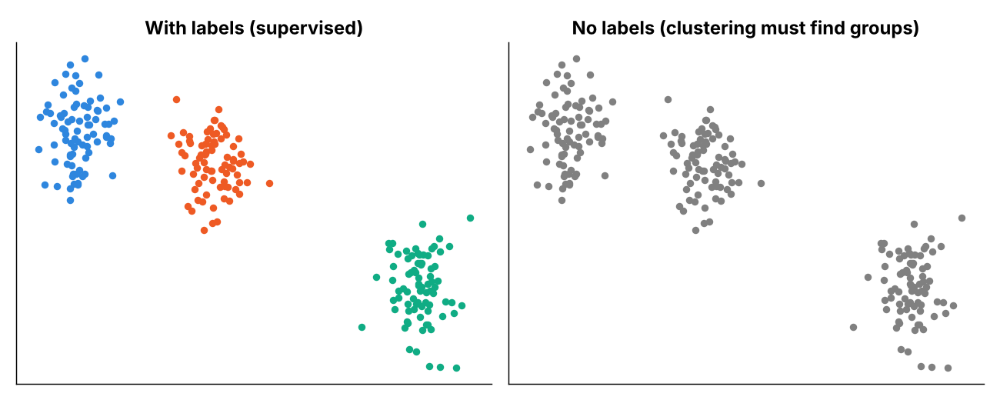
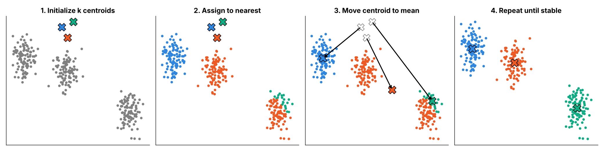
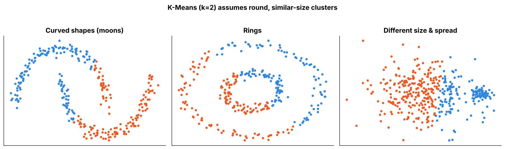
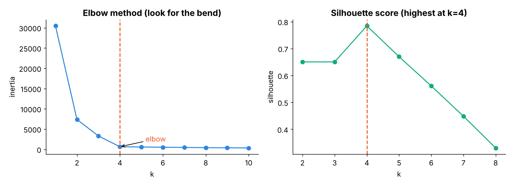
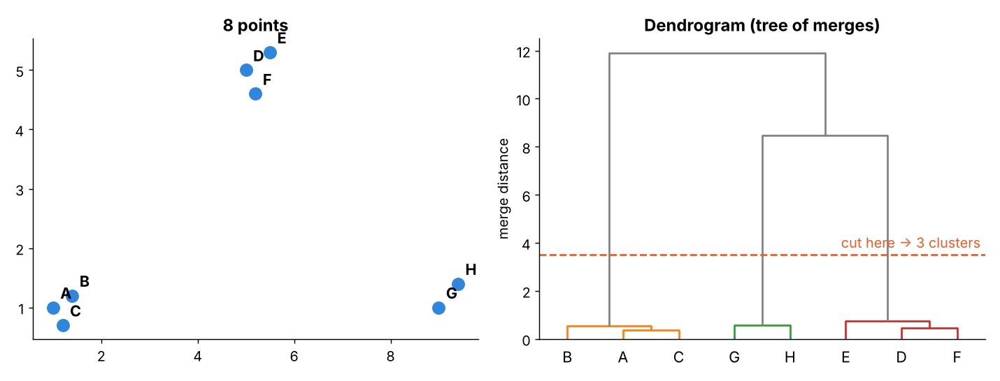
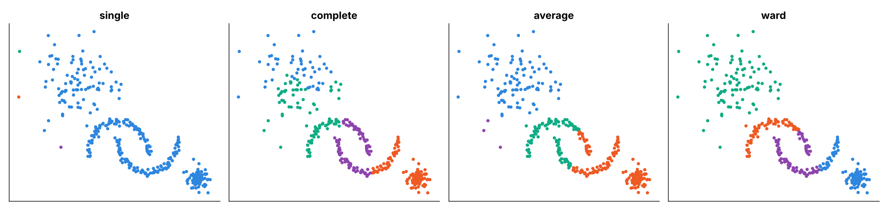
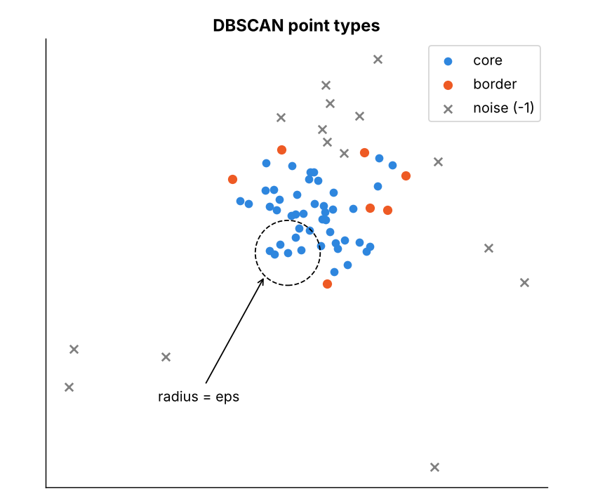
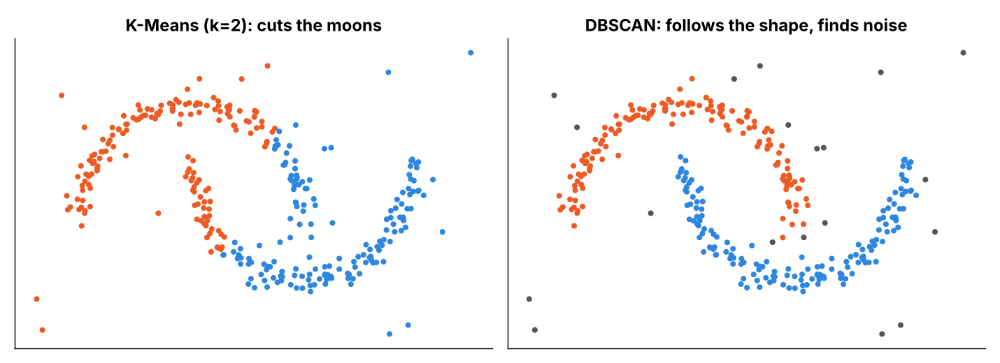
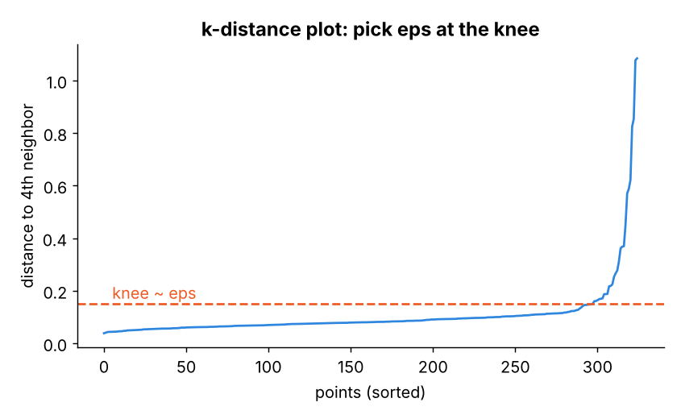

# Clustering – A Short Illustrated Guide

A concise summary of the *Clustering* lecture (TriNode Team): what clustering is, and how **K-Means**, **Hierarchical Clustering** and **DBSCAN** work, with tips for choosing parameters and evaluating results.

## Contents

1. [What is Clustering?](#1-what-is-clustering)
2. [Distance & Scaling](#2-distance--scaling)
3. [K-Means](#3-k-means)
4. [Choosing k](#4-choosing-k)
5. [Evaluating Clusters](#5-evaluating-clusters)
6. [Hierarchical Clustering](#6-hierarchical-clustering)
7. [DBSCAN](#7-dbscan)
8. [Which Algorithm Should I Use?](#8-which-algorithm-should-i-use)

---

## 1. What is Clustering?

Clustering is **unsupervised learning**: we only have features `X`, with **no labels** `y`. The goal is to group data so that points in the same group are similar and points in different groups are different.



**Common uses:** customer segmentation, grouping news/documents by topic, image color compression, anomaly/fraud detection, exploring a new dataset.

There is no "accuracy" here. We judge clusters by how **compact** and **well separated** they are, and whether they make sense.

---

## 2. Distance & Scaling

Similarity is measured as **distance**, usually Euclidean:

```
d(x, z) = sqrt( sum_j (x_j - z_j)^2 )
```

- **Always scale first** (e.g. `StandardScaler`). A feature in thousands (salary) will swamp one in tens (age).
- The features you choose define what "similar" means.
- With too many features, distances become alike (*curse of dimensionality*), so reduce dimensions if needed.

---

## 3. K-Means

Each cluster is represented by its center, the **centroid** (the mean of its points).



**Algorithm (Lloyd's):**

1. **Initialize** – pick `k` starting centroids.
2. **Assign** – each point joins the nearest centroid.
3. **Update** – move each centroid to the mean of its points.
4. **Repeat** steps 2–3 until the labels stop changing (or `max_iter`).

**What it minimizes:** *inertia* (WCSS) = sum of squared distances from each point to its own centroid. Each step can only lower it, so K-Means always stops.

```python
from sklearn.cluster import KMeans

Model = KMeans(n_clusters=4, n_init=10, random_state=0).fit(X)
Model.labels_            # cluster of each point
Model.cluster_centers_   # the centroids
Model.inertia_           # within-cluster sum of squares
```

**Good to know**

- **Initialization matters.** A bad start can get stuck in a poor solution. scikit-learn uses **k-means++** by default and `n_init` restarts, keeping the lowest-inertia run. Set `random_state` for repeatable results.
- **Limitations:** K-Means assumes round clusters of similar size, must use exactly `k` clusters, and forces outliers into a cluster.



---

## 4. Choosing k

Inertia always falls as `k` grows (at `k = n` it is 0), so we can't just pick the minimum.



- **Elbow method:** plot inertia for `k = 1, 2, 3, ...` and pick the bend, after which extra clusters give small gains.
- **Silhouette score:** pick the `k` with the highest score.

```
s(i) = (b(i) - a(i)) / max(a(i), b(i))
```

`a(i)` = mean distance to its own cluster, `b(i)` = mean distance to the nearest other cluster.
Close to **1** = clearly in its cluster, near **0** = on a border, **negative** = probably wrong cluster.

The elbow is only a guide. Combine it with the silhouette score and domain knowledge.

---

## 5. Evaluating Clusters

| Score | Best value | Needs labels? |
|---|---|---|
| `inertia_` | low | No |
| `silhouette_score` | 1 | No |
| `davies_bouldin_score` | 0 | No |
| `adjusted_rand_score` (ARI) | 1 | **Yes** |

- **Internal** scores use only the data. **External** scores (ARI) compare against known labels and are only for checking.
- Always do a practical check: look at cluster sizes, centroids and examples. Do they mean something?

---

## 6. Hierarchical Clustering

Builds **clusters inside clusters**, with no need to choose `k` in advance.

**Agglomerative (bottom-up):**

1. Every point starts as its own cluster.
2. Merge the two closest clusters and record the distance.
3. Repeat until one cluster is left (`n - 1` merges).
4. **Cut the tree** to get the clusters you want.

The result is shown as a **dendrogram**: leaves are points, each horizontal bar is a merge, and its height is the merge distance. A horizontal cut gives the clusters, and a long vertical gap suggests a natural number of clusters.



```python
from scipy.cluster import hierarchy as h

Z = h.linkage(points, method="ward")
h.dendrogram(Z, labels=names)
```

### Linkage: how far apart are two clusters?

| Linkage | Distance between clusters | Behavior |
|---|---|---|
| `single` | closest pair | Follows chains and curves, but sensitive to noise |
| `complete` | farthest pair | Compact clusters of similar size |
| `average` | mean of all pairs | Compromise between single and complete |
| `ward` | smallest increase in WCSS | Even pieces, like K-Means (**default in scikit-learn**) |



```python
from sklearn.cluster import AgglomerativeClustering

labels = AgglomerativeClustering(n_clusters=3, linkage="ward").fit_predict(X)
```

---

## 7. DBSCAN

Density-based clustering: a cluster is a **dense region**, separated from others by sparse regions.



| Point type | Definition |
|---|---|
| **Core** | Has at least `min_samples` points (itself included) within distance `eps` |
| **Border** | Not core, but within `eps` of a core point, so it joins that cluster |
| **Noise** | Neither of the above, labeled `-1` (no cluster) |

**How it builds clusters:** find core points, connect core points within `eps` of each other, attach border points, and label everything else as noise.

**Two settings:**

- `eps` – neighborhood radius. *Too small* means everything is noise; *too large* means everything merges into one cluster.
- `min_samples` – how many neighbors make a point "dense".

```python
from sklearn.cluster import DBSCAN

db = DBSCAN(eps=0.15, min_samples=5).fit(X)
db.labels_   # -1 = noise
```



### Choosing eps: the k-distance plot

For each point, compute the distance to its k-th nearest neighbor (`k = min_samples - 1`), sort, and plot. Pick `eps` at the **knee** where the curve shoots up: below it are cluster points, above it noise. Remember to scale features first.



---

## 8. Which Algorithm Should I Use?

| | K-Means | Hierarchical | DBSCAN |
|---|---|---|---|
| Number of clusters | You choose `k` | Choose after (cut the tree) | Found automatically |
| Cluster shape | Round | Depends on linkage | Any shape |
| Outliers | Forced into clusters | Forced into clusters | Marked as noise |
| Main settings | `k` | `linkage`, cut height | `eps`, `min_samples` |
| Weakness | Non-round shapes, unequal sizes | Slow on large data | Very different densities |

**Quick checklist**

1. Scale your features.
2. Try K-Means first and pick `k` with the elbow + silhouette.
3. If shapes are curved or you have outliers, try DBSCAN.
4. If you want to see the nested structure, use hierarchical clustering with a dendrogram.
5. Always inspect the clusters and check that they make sense.

---

*Based on the "Clustering" lecture by TriNode Team. Figures are generated illustrations of the concepts, not copies of the lecture slides.*
