# Support Vector Machines (SVM) — Lecture Notes

> Based on the lecture **"Support Vector Machines"** presented by the **TriNode Team**.
> This README walks through the lecture in order, with diagrams that make each idea visual.

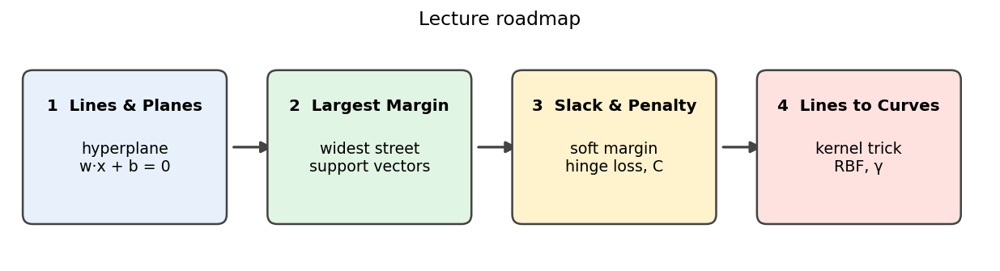

## Table of Contents

1. [The Big Idea](#1-the-big-idea)
2. [Lines & Planes (Hyperplanes)](#2-lines--planes-hyperplanes)
3. [Distance to the Hyperplane](#3-distance-to-the-hyperplane)
4. [The Margin & Support Vectors](#4-the-margin--support-vectors)
5. [Measuring the Margin: 2 / ‖w‖](#5-measuring-the-margin-2--w)
6. [The Optimization Problem (Hard Margin)](#6-the-optimization-problem-hard-margin)
7. [Soft Margins & Slack](#7-soft-margins--slack)
8. [Hinge Loss & the Objective](#8-hinge-loss--the-objective)
9. [The Hyperparameter C](#9-the-hyperparameter-c)
10. [When a Line Is Not Enough](#10-when-a-line-is-not-enough)
11. [The Kernel Trick](#11-the-kernel-trick)
12. [Common Kernels](#12-common-kernels)
13. [The RBF Kernel & γ](#13-the-rbf-kernel--γ)
14. [Tuning C and γ Together](#14-tuning-c-and-γ-together)
15. [Cheat Sheet](#15-cheat-sheet)

---

## 1. The Big Idea

**Separate the classes with the widest possible street.**

For two classes, SVM looks for a straight line (in 2-D) or a flat **hyperplane** (in higher dimensions) that separates them.

- There are usually **infinitely many** lines that separate the data. Which one will work best on *new* points?
- SVM picks the line that stays **as far as possible from the closest points of both classes**. This is called the **maximum margin**.
- **Why it helps:** a wide safety gap means small changes or noise in new data are less likely to push a point to the wrong side.

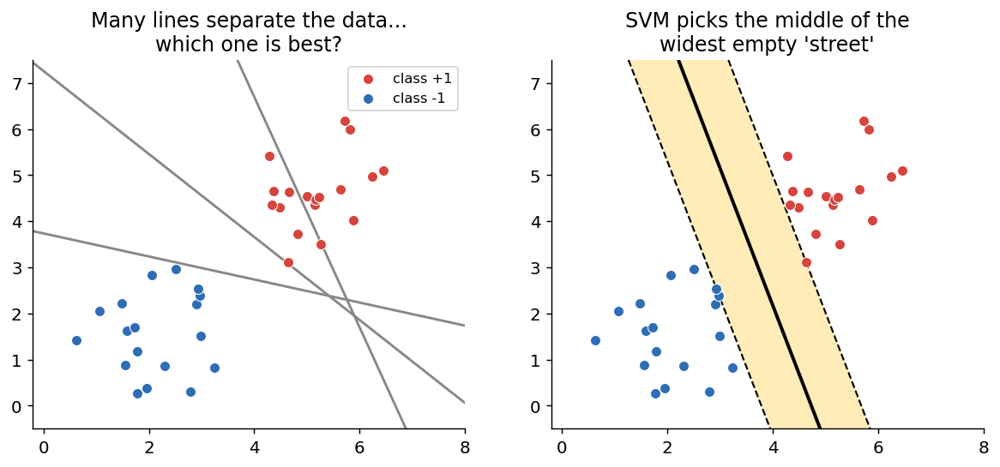

*Left: three lines that all separate the data. Right: SVM's choice, the middle of the widest empty street.*

---

## 2. Lines & Planes (Hyperplanes)

A **hyperplane** is the set of points where:

$$w \cdot x + b = 0$$

In 2-D it is a line, in 3-D a plane.

| Symbol | Meaning |
|---|---|
| **w** | weight vector, **perpendicular** to the hyperplane (it gives the direction) |
| **b** | bias, shifts the hyperplane away from the origin |
| **w·x** | $w_1x_1 + w_2x_2 + \dots + w_nx_n$ |

**Which side of the line?** The sign of $w \cdot x + b$ tells you:

- positive → class **+1**
- negative → class **−1**

(SVM writes the two classes as $y = +1$ and $y = -1$, which makes the math neat.)

**Example:** $w = (2, 1)$, $b = -4$ → the line $2x_1 + x_2 = 4$.
For the point $(3, 2)$: $2\cdot3 + 2 - 4 = 4 > 0$ → class **+1**.

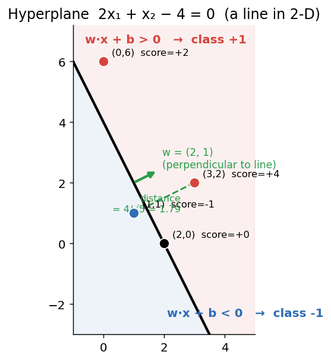

---

## 3. Distance to the Hyperplane

How far is a point from the boundary?

$$\text{distance} = \frac{|w \cdot x + b|}{\lVert w \rVert}, \qquad \lVert w \rVert = \sqrt{w_1^2 + w_2^2 + \dots + w_n^2}$$

- Dividing by $\lVert w \rVert$ turns a raw **score** into a real **distance**.
- Without the absolute value you get the **signed distance**, whose sign also says which side the point is on.
- Points **far** from the hyperplane are classified with **more confidence** than points close to it.

**Example:** $w=(2,1)$, $b=-4$, $x=(3,2)$ → $|4|/\sqrt5 = 1.79$ (the green dashed segment in the figure above).

### In code

```python
import numpy as np

w = np.array([2.0, 1.0])            # normal vector
b = -4.0                            # bias
points = np.array([[1, 1], [3, 2], [2, 0], [0, 6]])
scores = points @ w + b
dist = scores / np.linalg.norm(w)
for p, s, d in zip(points, scores, dist):
    side = "+1" if s > 0 else ("-1" if s < 0 else "on line")
    print(f"x={p} score={s:5.1f} dist={d:5.2f} class {side}")
```

```
x=[1 1] score= -1.0 dist=-0.45 class -1
x=[3 2] score=  4.0 dist= 1.79 class +1
x=[2 0] score=  0.0 dist= 0.00 class on line
x=[0 6] score=  2.0 dist= 0.89 class +1
```

---

## 4. The Margin & Support Vectors

- **Margin:** the distance between the two dashed lines $w \cdot x + b = +1$ and $w \cdot x + b = -1$. **No training point lies inside** this street.
- **Support vectors:** the training points that lie **exactly on the dashed lines**. They "hold up the street" on both sides.
- **Only they matter:** move or delete any *other* point and the hyperplane stays the same. Move a support vector and it changes.
- **Hard margin:** when the classes can be separated perfectly, SVM demands that every point is on the correct side of its dashed line.

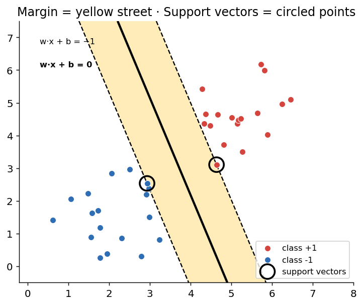

*Solid line = the hyperplane. Dashed lines touch the support vectors (circled). Yellow band = the margin.*

---

## 5. Measuring the Margin: 2 / ‖w‖

**Scale convention:** choose $w$ and $b$ so that the closest points have $w \cdot x + b = \pm 1$.

1. Those points are at distance $|\pm1| / \lVert w \rVert = 1/\lVert w \rVert$ from the hyperplane. *(half the street)*
2. Both sides together:

$$\text{margin} = \frac{2}{\lVert w \rVert}$$

3. **A smaller $\lVert w \rVert$ means a wider margin.**

**Constraint:** every training point must be outside the street:

$$y_i\,(w \cdot x_i + b) \ge 1$$

**Examples:** $w=(0.6, 0.8)$ → $\lVert w\rVert = 1$ → margin $= 2$. And $w=(1.2, 1.6)$ → $\lVert w\rVert = 2$ → margin $= 1$.

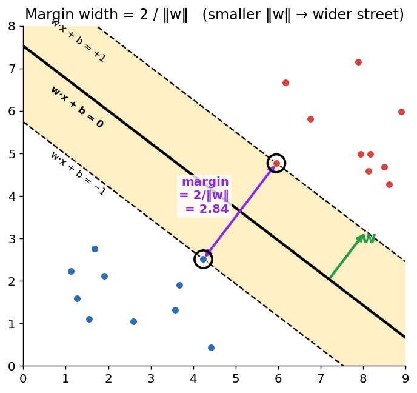

*This figure uses the lecture's trained values $w=(0.427, 0.56)$, $b=-4.217$, which give a margin of 2.84.*

---

## 6. The Optimization Problem (Hard Margin)

**Maximize the margin = minimize $\lVert w \rVert$.**

Maximizing $2/\lVert w\rVert$ is the same as minimizing $\lVert w\rVert$, or the smoother $\tfrac12\lVert w\rVert^2$:

$$\begin{aligned}
&\text{minimize} && \tfrac12 \lVert w \rVert^2 \\
&\text{subject to} && y_i\,(w \cdot x_i + b) \ge 1 \quad \text{for every } i
\end{aligned}$$

- **Solution:** $w = \sum_i \alpha_i\, y_i\, x_i$ — built from **support vectors only**.
- **Prediction:** $\text{sign}(w \cdot x + b)$.
- **Convex:** this is a *quadratic program* with a single best solution — **no local minima**, unlike neural networks.
- **Dual form:** solved with **Lagrange multipliers** $\alpha_i$; only support vectors get $\alpha_i > 0$. The dual uses **only dot products** $x_i \cdot x_j$ *(this fact becomes crucial for kernels later!)*.

### Training a maximum-margin classifier

```python
from sklearn.svm import SVC

m = SVC(kernel="linear", C=1000).fit(X, y)   # large C ≈ hard margin
Z = m.decision_function(grid).reshape(a.shape)
plt.contour(a, b, Z, levels=[-1, 0, 1], linestyles=["--", "-", "--"])
plt.scatter(*X.T, c=y, cmap="coolwarm")
plt.scatter(*m.support_vectors_.T, s=200, fc="none", ec="k")   # circle the SVs
plt.show()
```

### Looking inside the trained model

```python
m = SVC(kernel="linear", C=1000).fit(X, y)
w, b = m.coef_[0], m.intercept_[0]
print("w =", w.round(3), " b =", round(b, 3))
print("support vectors per class:", m.n_support_)
print("support vectors:")
print(m.support_vectors_.round(2))
print("margin 2/||w|| =", round(2 / np.linalg.norm(w), 3))
scores = m.decision_function(m.support_vectors_)
print("w·x + b at the support vectors:", scores.round(3))
```

```
w = [0.427 0.56 ]   b = -4.217
support vectors per class: [1 1]
support vectors:
[[4.24 2.51]
 [5.96 4.77]]
margin 2/||w|| = 2.839
w·x + b at the support vectors: [-1.  1.]
```

| scikit-learn attribute | Meaning |
|---|---|
| `coef_` | $w$ |
| `intercept_` | $b$ |
| `support_vectors_` | the support vector points |
| `n_support_` | number of support vectors per class |

Notice that the support vectors score **exactly −1 and +1**.

---

## 7. Soft Margins & Slack

**Real data is rarely perfectly separable.** With overlap or outliers, no hyperplane separates the classes and the hard-margin problem has **no solution**.

**Fix: slack variables $\xi_i$.** Allow point $i$ to break the rule by an amount $\xi_i \ge 0$:

$$y_i\,(w \cdot x_i + b) \ge 1 - \xi_i$$

**Reading $\xi$:**

| Value of ξ | Where the point is |
|---|---|
| $\xi = 0$ | outside the street (all good) |
| $0 < \xi \le 1$ | **inside** the street but still on the **correct** side |
| $\xi > 1$ | on the **wrong** side of the hyperplane |

**Robust:** one outlier no longer forces a narrow or impossible boundary.

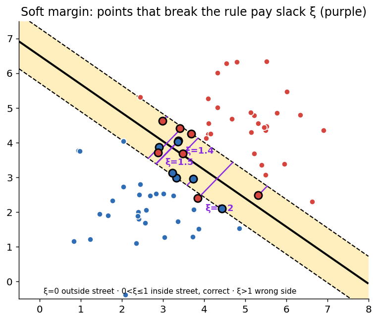

*Overlapping classes: a few points sit inside the margin or on the wrong side, each paying a slack ξ (purple segments).*

---

## 8. Hinge Loss & the Objective

Two goals pull against each other:

1. Keep $\lVert w \rVert$ small → **wide margin**
2. Keep the total slack $\sum \xi_i$ small → **few violations**

$$\min_{w,b}\;\; \tfrac12 \lVert w \rVert^2 \;+\; C \sum_i \max\!\big(0,\; 1 - y_i (w \cdot x_i + b)\big)$$

| Term | Role |
|---|---|
| $\tfrac12\lVert w\rVert^2$ | makes the margin wide |
| $C$ | cost of violations — **the main hyperparameter of an SVM** |
| $\max(0, 1 - y f)$ | **hinge loss** = slack $\xi_i$ |

**Hinge loss:** the slack of a point equals $\max(0, 1 - y_i f(x_i))$ where $f = w\cdot x + b$:

- **zero** for points outside the street ($y f \ge 1$),
- **grows linearly** inside the street and beyond.

**Example:** $y=+1$, $f(x)=0.3$ → hinge $= 1 - 0.3 = 0.7$ (inside the street, still correct).

**Same as:** hinge loss + an L2 penalty on $w$ — like regularized logistic regression, but with a different loss.

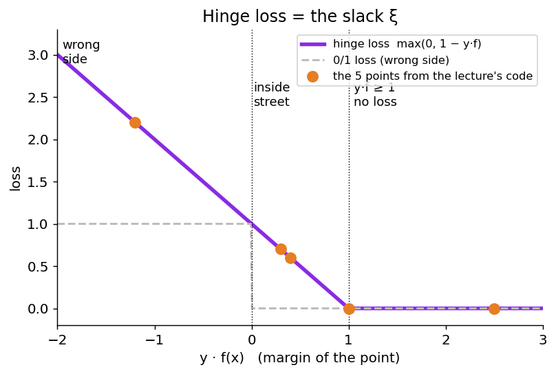

### In code

```python
def hinge(y, f):
    return np.maximum(0, 1 - y * f)

y = np.array([1, 1, 1, -1, -1])
f = np.array([2.5, 1.0, 0.3, -0.4, 1.2])   # scores w·x + b
for yi, fi, m, h in zip(y, f, y * f, hinge(y, f)):
    print(f"y={yi:+d} f={fi:+.1f} y*f={m:+.1f} loss={h:.1f}")

w, C = np.array([0.8, 0.6]), 1.0
J = 0.5 * w @ w + C * hinge(y, f).sum()
print("objective 0.5*||w||^2 + C*sum(hinge) =", round(J, 2))
```

```
y=+1 f=+2.5 y*f=+2.5 loss=0.0
y=+1 f=+1.0 y*f=+1.0 loss=0.0
y=+1 f=+0.3 y*f=+0.3 loss=0.7
y=-1 f=-0.4 y*f=+0.4 loss=0.6
y=-1 f=+1.2 y*f=-1.2 loss=2.2
objective 0.5*||w||^2 + C*sum(hinge) = 4.0
```

Reading the output: $y f \ge 1$ → **no loss**; $0 < yf < 1$ → inside the street; $yf < 0$ → **wrong side**, loss $> 1$.

---

## 9. The Hyperparameter C

**C is the price of one unit of slack.**

| | Small C | Large C |
|---|---|---|
| Violations are... | cheap | expensive |
| Margin | **wide**, tolerant | **narrow**, strict |
| Model | simpler, can **underfit** | tries to classify every training point, can **overfit** |
| Support vectors | **many** (every point on or inside the margin is one) | **few** |

**Tuning:** try values on a log scale (0.01, 0.1, 1, 10, 100) and pick C by **cross-validation**.

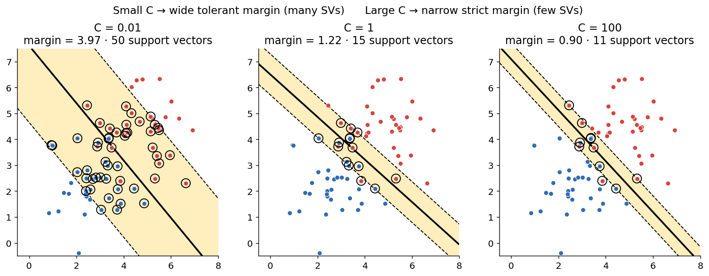

*Illustrative data generated for this README. The lecture's own run on 70 overlapping points reports the same trend, shown below.*

### In code (lecture results)

```python
for C in [0.01, 0.1, 1, 10, 100]:
    m = SVC(kernel="linear", C=C).fit(X, y)
    margin = 2 / np.linalg.norm(m.coef_)
    print(f"C={C:<5} margin={margin:.2f} "
          f"SVs={len(m.support_):2} "
          f"train acc={m.score(X, y):.3f}")
```

```
C=0.01   margin=4.33   SVs=34   train acc=0.986
C=0.1    margin=2.39   SVs=13   train acc=0.986
C=1      margin=1.68   SVs= 5   train acc=0.986
C=10     margin=1.60   SVs= 5   train acc=0.986
C=100    margin=1.60   SVs= 5   train acc=0.986
```

Watch the margin **shrink** and the support-vector count **drop** as C grows.

---

## 10. When a Line Is Not Enough

Some classes are wrapped around each other, like a **ring around a center**: no straight line can split them.

**Idea: map the data to a space where it *is* separable.**

- **Add features:** map each point $x$ to $\varphi(x)$ with new features, e.g. $z = x_1^2 + x_2^2$ (the squared distance from the center).
- **Linear up there:** in the new space a flat hyperplane separates the classes; back in 2-D it becomes a **circle**.
- **The cost:** with many features the mapping explodes — degree-3 combinations of 100 features is about **176,000 features**.

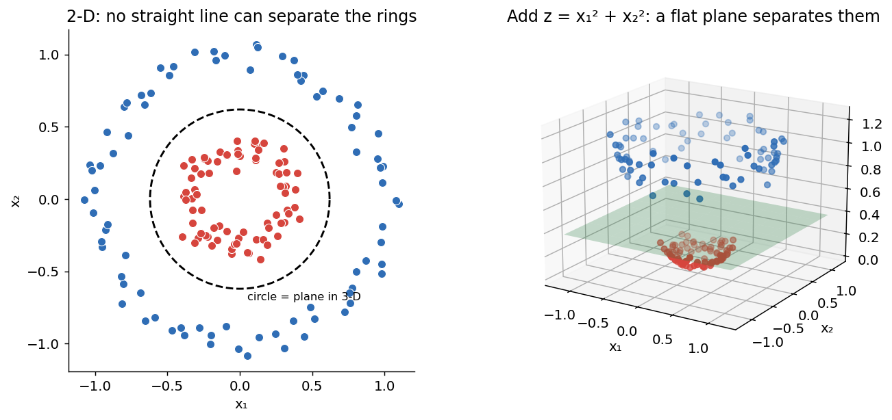

*Left: rings in 2-D. Right: after adding $z = x_1^2 + x_2^2$ they are separable by a flat plane.*

The explosion in cost is exactly the problem the **kernel trick** solves.

---

## 11. The Kernel Trick

**Dot products in a big space, computed in the small one.**

The SVM's dual problem and its predictions use the data **only through dot products** $x_i \cdot x_j$.

- **Replace them:** swap each $x_i \cdot x_j$ for $\varphi(x_i) \cdot \varphi(x_j)$ to train in the mapped space.
- **Kernel function:** a kernel gives that number directly, **without ever computing $\varphi$**:

$$K(x, z) = \varphi(x) \cdot \varphi(z)$$

**Worked example** with $\varphi(x) = (x_1^2,\; \sqrt2\,x_1x_2,\; x_2^2)$ and $K(x,z) = (x\cdot z)^2$:

For $x=(1,2)$ and $z=(3,1)$:

- $(x \cdot z)^2 = 5^2 = 25$
- $\varphi(x)\cdot\varphi(z) = 9 + 12 + 4 = 25$ ✅ same answer

**Even infinite:** the RBF kernel corresponds to an *infinite-dimensional* $\varphi$, yet computing $K$ costs about as much as a distance.

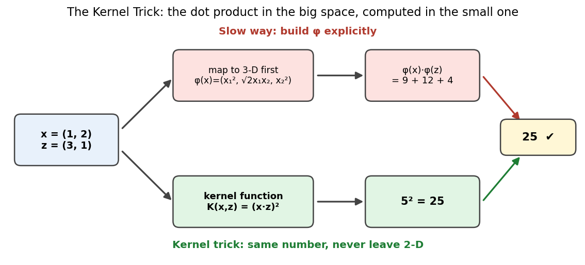

### In code

```python
def phi(v):                          # explicit map to 3-D
    return np.array([v[0]**2, np.sqrt(2)*v[0]*v[1], v[1]**2])

x, z = np.array([1.0, 2.0]), np.array([3.0, 1.0])
print("phi(x) . phi(z) =", round(phi(x) @ phi(z), 6))
print("(x . z)^2       =", (x @ z) ** 2)

def rbf(x, z, gamma=0.5):
    return np.exp(-gamma * np.sum((x - z) ** 2))

print("RBF(x, z) =", round(rbf(x, z), 4))
print("RBF(x, x) =", rbf(x, x))
```

```
phi(x) . phi(z) = 25.0
(x . z)^2       = 25.0
RBF(x, z) = 0.0821
RBF(x, x) = 1.0
```

RBF is a **similarity** from 1 (identical points) down toward 0 (far apart).

---

## 12. Common Kernels

| `kernel=` in scikit-learn | Formula | Settings | When to use |
|---|---|---|---|
| `"linear"` | $x\cdot z$ | `C` | many features (e.g. text), or data already close to linearly separable |
| `"poly"` | $(\gamma\, x\cdot z + r)^d$ | `C`, `degree`, `gamma` | curved boundaries of degree $d$; unstable for large $d$ |
| `"rbf"` | $\exp(-\gamma\lVert x-z\rVert^2)$ | `C`, `gamma` | **the default and the most popular** |
| `"sigmoid"` | $\tanh(\gamma\, x\cdot z + r)$ | `C`, `gamma` | inspired by neural networks; rarely the best choice |

*($r$ is `coef0` in scikit-learn.)*

### Comparing kernels on the "moons" dataset

```python
kernels = ["linear", "poly", "rbf"]
fig, axs = plt.subplots(1, 3, figsize=(12, 4))
for ax, k in zip(axs, kernels):
    m = SVC(kernel=k).fit(X, y)
    Z = m.predict(grid).reshape(a.shape)
    ax.contourf(a, b, Z, alpha=0.3)
    ax.scatter(*X.T, c=y, s=12)
    ax.set_title(f"{k}: {m.score(X, y):.2f}")   # training accuracy
plt.show()
```

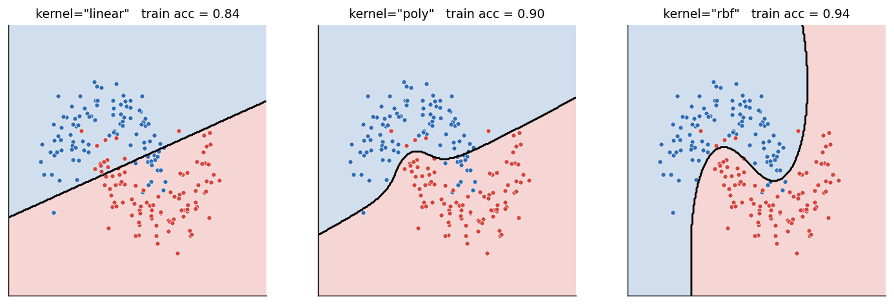

*Linear gives a straight boundary; poly and rbf give curved ones. Titles show training accuracy.*

---

## 13. The RBF Kernel & γ

$$K(x, z) = \exp\!\big(-\gamma\,\lVert x - z\rVert^2\big)$$

- **Similarity:** $K = 1$ when two points are identical and falls toward $0$ as they move apart.
- **γ (gamma)** controls *how far each training point's influence reaches*:

| γ | Each point influences... | Boundary | Risk |
|---|---|---|---|
| **small** | a wide area | smooth, almost linear | underfit |
| **large** | only its close neighborhood | wiggly, islands around single points | overfit |

**Example:** $\lVert x-z\rVert^2 = 5$:
- $\gamma = 0.5$ → $\exp(-2.5) = 0.082$
- $\gamma = 0.05$ → $0.779$

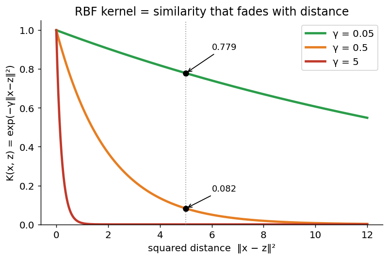

### γ in pictures (same moons data, C = 1)

| γ | What happens |
|---|---|
| **0.1** | Almost a straight line: it misses the curved shape of the moons |
| **1** | Follows the two moons smoothly: **the right level of detail** |
| **50** | Draws islands around single points: **memorizes the noise** |

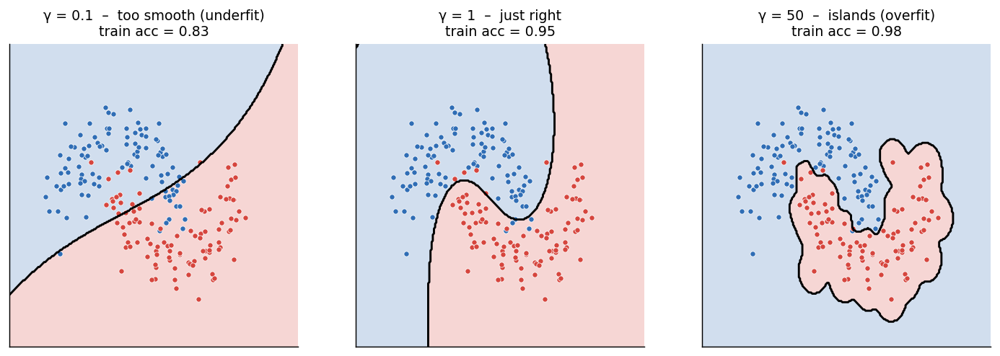

---

## 14. Tuning C and γ Together

Both hyperparameters control model complexity, so **search them together as a grid on log scales** (for example with `GridSearchCV`).

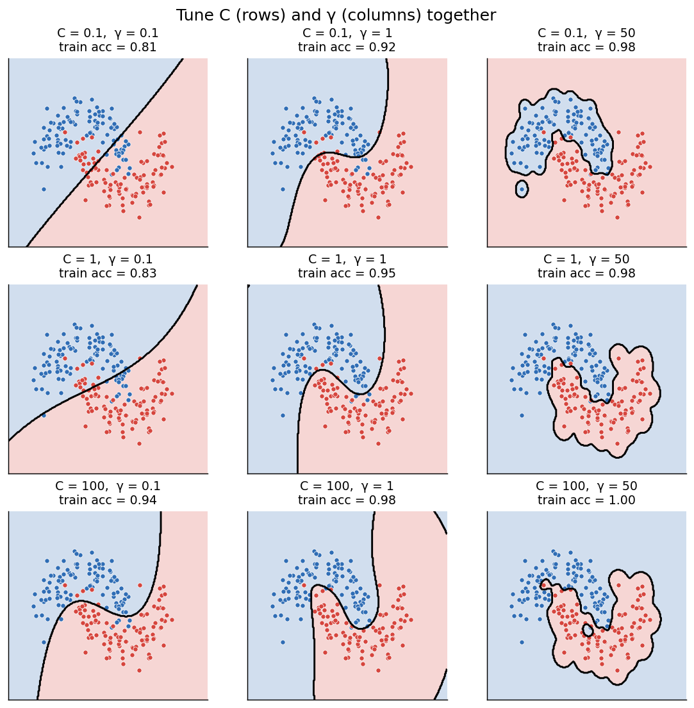

*Rows: increasing C (stricter on errors). Columns: increasing γ (more local, wigglier boundary). The sweet spot is usually in the middle.*

```python
from sklearn.model_selection import GridSearchCV

param_grid = {"C": [0.1, 1, 10, 100], "gamma": [0.01, 0.1, 1, 10]}
search = GridSearchCV(SVC(kernel="rbf"), param_grid, cv=5).fit(X, y)
print(search.best_params_, search.best_score_)
```

---

## 15. Cheat Sheet

| Concept | One-line summary |
|---|---|
| **Hyperplane** | $w\cdot x + b = 0$; the sign of the score gives the class |
| **Distance** | $\lvert w\cdot x + b\rvert / \lVert w\rVert$ |
| **Margin** | $2/\lVert w\rVert$ — the width of the empty street |
| **Support vectors** | points on the street edges; the *only* points that define the model |
| **Hard-margin SVM** | minimize $\tfrac12\lVert w\rVert^2$ s.t. $y_i(w\cdot x_i+b)\ge1$ |
| **Slack $\xi_i$** | how much point $i$ violates the margin |
| **Hinge loss** | $\max(0, 1 - y f(x))$ = the slack |
| **C** | price of slack: small = wide & tolerant, large = narrow & strict |
| **Kernel trick** | compute $\varphi(x)\cdot\varphi(z)$ as $K(x,z)$ without building $\varphi$ |
| **RBF kernel** | $\exp(-\gamma\lVert x-z\rVert^2)$, the default choice |
| **γ** | small = smooth/underfit, large = wiggly/overfit |
| **Tuning** | grid-search C and γ on log scales with cross-validation |

### Quick start

```python
from sklearn.svm import SVC
from sklearn.preprocessing import StandardScaler
from sklearn.pipeline import make_pipeline

model = make_pipeline(StandardScaler(), SVC(kernel="rbf", C=1, gamma="scale"))
model.fit(X_train, y_train)
print(model.score(X_test, y_test))
```

> 💡 **Practical tip:** SVMs are sensitive to feature scale (distances and dot products are used everywhere), so **standardize your features** before training.

---

## About the images

All diagrams in the `images/` folder were generated with `matplotlib` and `scikit-learn` using the script `images/generate_figures.py`. They illustrate the ideas from the lecture; where a figure shows a lecture result (e.g. the example hyperplane, the trained $w$ and $b$, the RBF numbers), it reproduces the lecture's values. Plots of full datasets (e.g. effect of C, moons) use freshly generated sample data, so their exact numbers can differ slightly from the slides.

*Lecture presented by the TriNode Team.*
