# ML Lecture 11 — Ensemble Learning

> **Presented by TriNode Team** · Better Together: many models beat one model alone.

---

## What We Learn in This Lecture

By the end of this lecture you will be able to:

- **Explain** why combining many models gives better predictions than one model (wisdom of the crowd).
- **Diagnose** errors as **bias** (underfitting) or **variance** (overfitting), and pick the right ensemble for each.
- **Compare** the four ways to combine models: voting, bagging, boosting, stacking.
- **Build** a voting ensemble (hard vs. soft) in scikit-learn.
- **Use the bootstrap** (sampling with replacement) and understand why ~63.2% of rows are picked.
- **Train bagging and Random Forest**, and evaluate them for free with **out-of-bag (OOB)** scores.
- **Read feature importance** (impurity vs. permutation) and know its traps.
- **Understand boosting**: AdaBoost (re-weight hard examples) and Gradient Boosting (fit residuals).
- **Tune** learning rate, number of trees, depth and subsample, and stop with **early stopping**.
- **Choose** between bagging and boosting, and know when to use **XGBoost**, **LightGBM** or **HistGradientBoosting**.

**One-sentence summary:** *Bagging averages many deep trees to cut variance; boosting adds many shallow trees one by one to cut bias.*

---

## Table of Contents

1. [Introduction to Ensemble Learning](https://github.com/ali-raafat-33/Machine-Learning-Course/tree/main/ML%20Lec%20-11%20''Ensemble%20Learning''#1-introduction-to-ensemble-learning)
2. [Bias, Variance, and Ensembles](https://github.com/ali-raafat-33/Machine-Learning-Course/tree/main/ML%20Lec%20-11%20''Ensemble%20Learning''#2-bias-variance-and-ensembles)
3. [Ways to Combine Models](https://github.com/ali-raafat-33/Machine-Learning-Course/tree/main/ML%20Lec%20-11%20''Ensemble%20Learning''#3-ways-to-combine-models)
4. [Voting Ensembles](https://github.com/ali-raafat-33/Machine-Learning-Course/tree/main/ML%20Lec%20-11%20''Ensemble%20Learning''#4-voting-ensembles)
5. [Bootstrap Sampling](https://github.com/ali-raafat-33/Machine-Learning-Course/tree/main/ML%20Lec%20-11%20''Ensemble%20Learning''#5-bootstrap-sampling)
6. [Bagging](https://github.com/ali-raafat-33/Machine-Learning-Course/tree/main/ML%20Lec%20-11%20''Ensemble%20Learning''#6-bagging-bootstrap-aggregating)
7. [Out-of-Bag Evaluation](https://github.com/ali-raafat-33/Machine-Learning-Course/tree/main/ML%20Lec%20-11%20''Ensemble%20Learning''#7-out-of-bag-oob-evaluation)
8. [Random Forest](https://github.com/ali-raafat-33/Machine-Learning-Course/tree/main/ML%20Lec%20-11%20''Ensemble%20Learning''#8-random-forest)
9. [Feature Importance](https://github.com/ali-raafat-33/Machine-Learning-Course/tree/main/ML%20Lec%20-11%20''Ensemble%20Learning''#9-feature-importance)
10. [AdaBoost](https://github.com/ali-raafat-33/Machine-Learning-Course/tree/main/ML%20Lec%20-11%20''Ensemble%20Learning''#10-adaboost)
11. [Gradient Boosting](https://github.com/ali-raafat-33/Machine-Learning-Course/tree/main/ML%20Lec%20-11%20''Ensemble%20Learning''#11-gradient-boosting)
12. [Learning Rate and Number of Trees](https://github.com/ali-raafat-33/Machine-Learning-Course/tree/main/ML%20Lec%20-11%20''Ensemble%20Learning''#12-learning-rate-and-number-of-trees)
13. [Bagging vs. Boosting](https://github.com/ali-raafat-33/Machine-Learning-Course/tree/main/ML%20Lec%20-11%20''Ensemble%20Learning''#13-bagging-vs-boosting)
14. [Boosting at Scale: XGBoost and LightGBM](https://github.com/ali-raafat-33/Machine-Learning-Course/tree/main/ML%20Lec%20-11%20''Ensemble%20Learning''#14-boosting-at-scale-xgboost-and-lightgbm)
15. [Histogram Gradient Boosting](https://github.com/ali-raafat-33/Machine-Learning-Course/tree/main/ML%20Lec%20-11%20''Ensemble%20Learning''#15-histogram-gradient-boosting)
16. [Early Stopping](https://github.com/ali-raafat-33/Machine-Learning-Course/tree/main/ML%20Lec%20-11%20''Ensemble%20Learning''#16-early-stopping)
17. [Important Equations](https://github.com/ali-raafat-33/Machine-Learning-Course/tree/main/ML%20Lec%20-11%20''Ensemble%20Learning''#17-important-equations)
18. [Quick Reference](https://github.com/ali-raafat-33/Machine-Learning-Course/tree/main/ML%20Lec%20-11%20''Ensemble%20Learning''#18-quick-reference)
19. [Practice Questions](https://github.com/ali-raafat-33/Machine-Learning-Course/tree/main/ML%20Lec%20-11%20''Ensemble%20Learning''#19-practice-questions)

---

## 1. Introduction to Ensemble Learning

**Wisdom of the crowd:** ask many people to guess a number and average the answers — the average is often better than almost every single guess.

**Ensemble learning** does the same with models: train many models and combine their predictions by **voting** (classification) or **averaging** (regression).

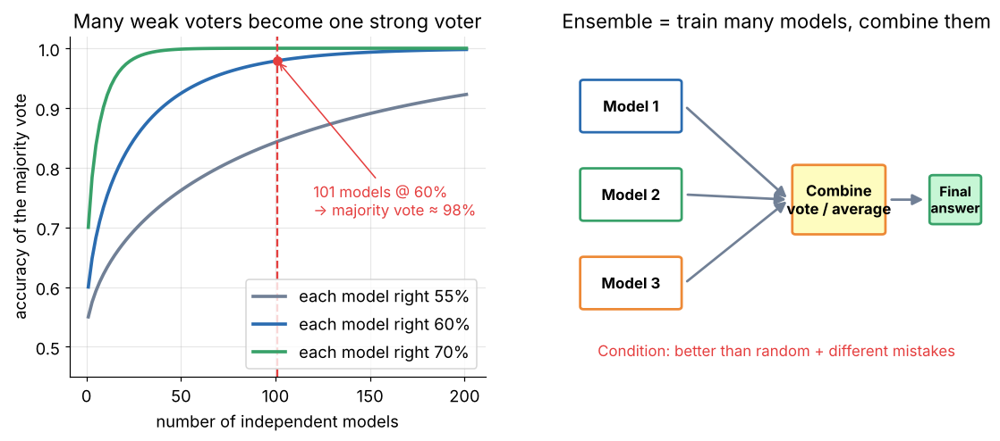

**How to read the image**
- **Left:** if each model is right only 60% of the time, the majority vote of **101 independent models is right ≈ 98%** of the time. More models → better vote.
- **Right:** several models feed one combiner that produces the final answer.

**The condition (very important)**

| Requirement | Why |
|---|---|
| Each model is **better than random** | A worse-than-random voter pushes the vote the wrong way |
| Models make **different mistakes** | Copies of one model add nothing — the same error is repeated |

**Where you see it:** Random Forest, XGBoost and LightGBM are all ensembles, and they win most competitions on **tabular data**.

---

## 2. Bias, Variance, and Ensembles

There are two kinds of error, and two kinds of ensemble to fix them.

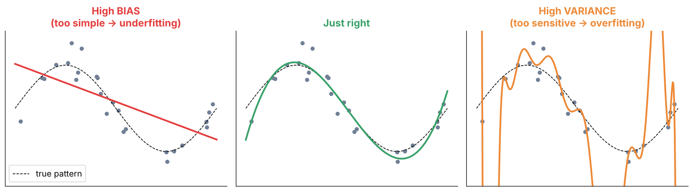

| Error | Meaning | Also called |
|---|---|---|
| **Bias** | The model is too simple — it misses the pattern on every dataset | Underfitting |
| **Variance** | The model is too sensitive — a small change in the data gives a very different model | Overfitting |

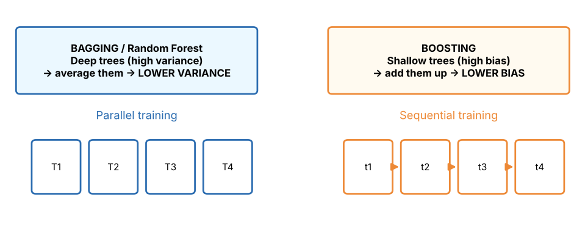

| | Bagging / Random Forest | Boosting |
|---|---|---|
| Base model | Deep tree | Shallow tree |
| Base error | High **variance** | High **bias** |
| Training | Parallel | Sequential |
| Reduces | **Variance** | **Bias** |

Both usually use **decision trees** as building blocks.

---

## 3. Ways to Combine Models

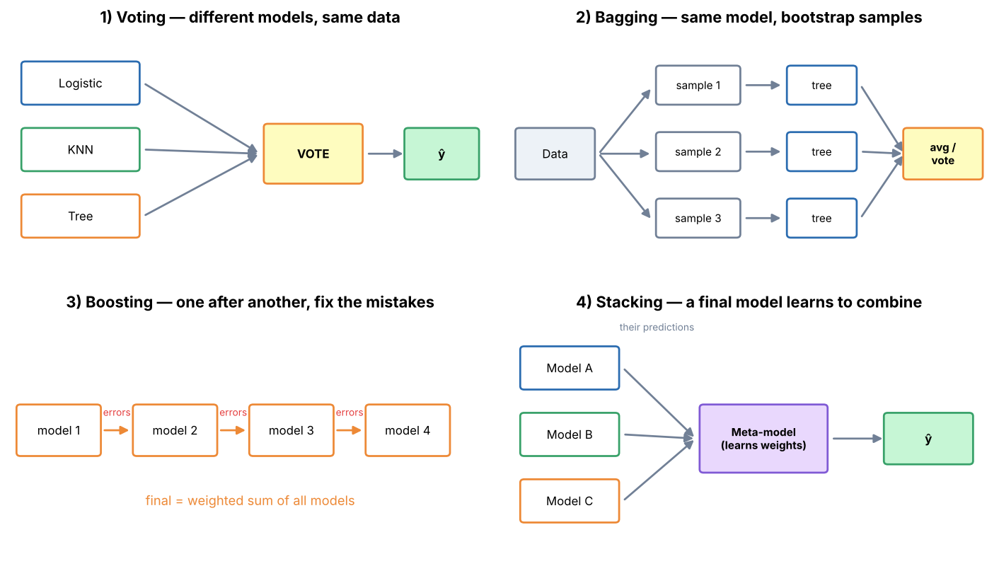

| Method | Idea | scikit-learn class |
|---|---|---|
| **Voting** | Different kinds of models on the same data; they vote (hard) or average probabilities (soft) | `VotingClassifier` |
| **Bagging** | Same kind of model on different bootstrap samples, then vote/average | `BaggingClassifier` |
| **Random Forest** | Bagging of trees + random features at every split | `RandomForestClassifier` |
| **Boosting** | Models trained one after another; each focuses on the previous mistakes | `AdaBoost…`, `GradientBoosting…` |
| **Stacking** | Predictions of several models go into a final model that learns how to combine them | `StackingClassifier` |

Every class also has a **Regressor** version (e.g. `RandomForestRegressor`).

---

## 4. Voting Ensembles

Train **different** models on the **same** data and combine them.

- **Hard voting:** majority of the predicted **labels**.
- **Soft voting:** **average the probabilities**, then pick the highest (uses model confidence).

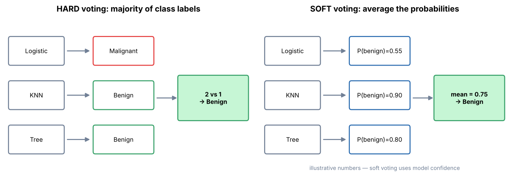

*(The probabilities in the picture are illustrative.)*

**Code from the lecture** — breast cancer data, 75% train / 25% test; logistic regression, KNN and a decision tree:

```python
scaled = lambda m: make_pipeline(StandardScaler(), m)
models = [("logistic", scaled(LogisticRegression())),
          ("knn",      scaled(KNeighborsClassifier())),
          ("tree",     DecisionTreeClassifier(random_state=0))]
for name, m in models:
    acc = m.fit(X_tr, y_tr).score(X_te, y_te)
    print(f"{name:9} {acc:.3f}")
vote = VotingClassifier(models, voting="soft")
vote.fit(X_tr, y_tr)
print(f"vote      {vote.score(X_te, y_te):.3f}")
```

**Output (from the lecture)**

```
logistic  0.986
knn       0.979
tree      0.937
vote      0.958
```

> 💡 **Note:** here the vote (0.958) is better than the tree (0.937) but **not** better than logistic regression (0.986). Voting is not a guarantee — it helps most when the models are all good **and** make different mistakes.

---

## 5. Bootstrap Sampling

The **bootstrap** creates new datasets from the one you have: draw **n rows from the n training rows at random, putting each row back after drawing it** (sampling **with replacement**).

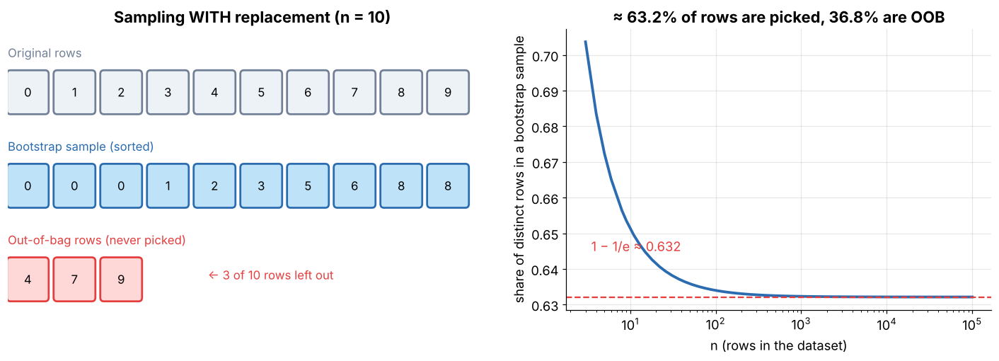

**How to read the image**
- **Left (n = 10):** the sample has repeated rows (duplicates) and some rows never appear — these are **out-of-bag**.
- **Right:** as n grows, the share of distinct rows converges to **1 − 1/e ≈ 0.632**.

$$P(\text{row picked}) = 1-\left(1-\tfrac{1}{n}\right)^n \;\longrightarrow\; 1-\tfrac{1}{e}\approx 0.632$$

| Symbol | Meaning |
|---|---|
| $(1-1/n)$ | chance a row is **missed** in one draw |
| $^n$ | n independent draws |
| $1-1/e$ | ≈ 0.632 for large n |

**Examples:** n = 10 → 1 − 0.9¹⁰ = **0.651**; n = 1000 → **0.632**.

**Why it helps:** each bootstrap sample is a slightly different dataset, so a model trained on it is slightly different too.

**Code and output (from the lecture)**

```python
rng = np.random.default_rng(0)
sample = rng.choice(10, size=10, replace=True)
print("bootstrap sample:", np.sort(sample))
print("out-of-bag:", np.setdiff1d(np.arange(10), sample))
for n in [10, 100, 1000, 100_000]:
    s = rng.choice(n, size=n, replace=True)
    print(f"n = {n:<7} distinct share = {len(np.unique(s)) / n:.3f}")
```

```
bootstrap sample: [0 0 0 1 2 3 5 6 8 8]
out-of-bag: [4 7 9]
n = 10      distinct share = 0.400
n = 100     distinct share = 0.610
n = 1000    distinct share = 0.628
n = 100000  distinct share = 0.632
```

---

## 6. Bagging (Bootstrap Aggregating)

**Average many models to cancel their noise.**

1. **Bootstrap** — draw **B** bootstrap samples from the training data.
2. **Train** — one model (usually a **deep decision tree**) on each sample. They can be trained **in parallel**.
3. **Aggregate** — classification: majority vote (or average probability); regression: average of predictions.

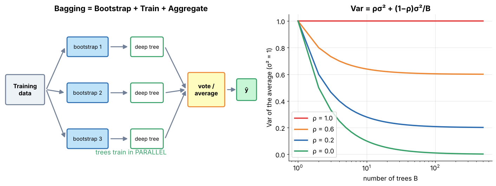

$$f_{\text{bag}}(x)=\frac{1}{B}\sum_{b=1}^{B} f_b(x) \qquad \mathrm{Var}=\rho\sigma^2+\frac{(1-\rho)\sigma^2}{B}$$

| Symbol | Meaning |
|---|---|
| $B$ | number of models (`n_estimators`) |
| $f_b$ | model trained on bootstrap sample $b$ |
| $\sigma^2$ | variance of one model |
| $\rho$ | correlation between models |

**Example:** σ² = 1, ρ = 0.5, B = 100 → Var = 0.5 + 0.005 = **0.505** instead of 1.

Each tree overfits in its own way; averaging cancels much of that noise, while the **bias stays the same**.

### Bagging in pictures

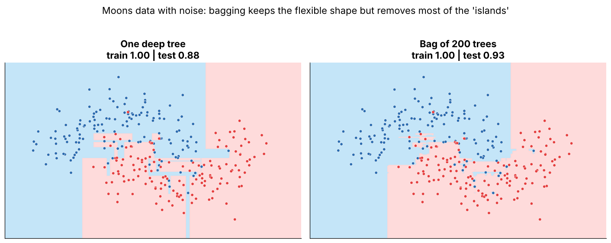

- **One deep tree** draws a jagged boundary with small "islands" around single noisy points.
- **A bag of trees** smooths the boundary — the vote cancels the islands.
- Both fit the training data (almost) perfectly, but the bag **generalizes better** (the lecture reports 0.90 vs. 0.85 on the test set).

### Bagging in code

```python
for n in [1, 5, 25, 100, 300]:
    bag = BaggingClassifier(DecisionTreeClassifier(),
                            n_estimators=n, random_state=0)
    acc = bag.fit(X_tr, y_tr).score(X_te, y_te)
    print(f"{n:3} trees: test accuracy = {acc:.3f}")
bag = BaggingClassifier(DecisionTreeClassifier(),
                        n_estimators=300, oob_score=True,
                        random_state=0).fit(X_tr, y_tr)
print("out-of-bag accuracy:", round(bag.oob_score_, 3))
```

**Output (from the lecture, noisy moons, 280 train / 120 test)**

```
  1 trees: test accuracy = 0.825
  5 trees: test accuracy = 0.867
 25 trees: test accuracy = 0.908
100 trees: test accuracy = 0.892
300 trees: test accuracy = 0.900
out-of-bag accuracy: 0.889
```

---

## 7. Out-of-Bag (OOB) Evaluation

**A validation score for free.** Each tree never saw about **37%** of the training rows — its **out-of-bag (OOB)** rows.

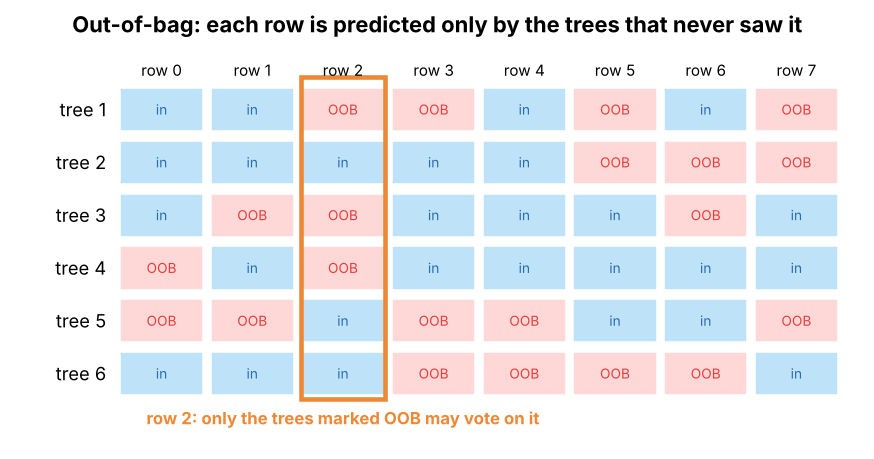

**How it works**
1. **OOB prediction:** for every training row, let **only the trees that did not see it** vote.
2. **OOB score:** the accuracy of those votes estimates test accuracy **without a separate validation set**.

**When it helps**
- small datasets — no rows wasted on validation;
- quick checks while tuning `n_estimators`;
- a sanity check next to cross-validation.

**In scikit-learn:** `oob_score=True` in `BaggingClassifier` or `RandomForestClassifier`, then read `oob_score_`.

---

## 8. Random Forest

**Random Forest = Bagging + random features at every split.**

**The problem with bagging:** with one very strong feature, every bagged tree splits on it first — the trees look alike and make similar errors.

**The fix:** at every split, consider only a **random subset** of features (`max_features`). Different trees are forced to use different features → their errors overlap less → averaging helps more.

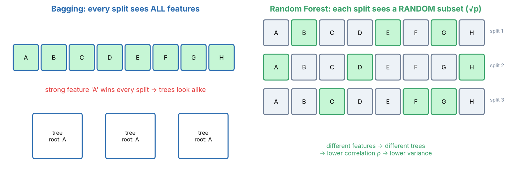

| | Bagging | Random Forest |
|---|---|---|
| Rows per tree | bootstrap | bootstrap |
| Features per split | all *p* | random **√p** |
| Tree correlation | higher | lower |
| Speed | slower | faster |

Breast cancer: p = 30 features → **5 per split**.

**Typical setting:** √p features per split for classification (all features for regression in scikit-learn).

### Why random features help

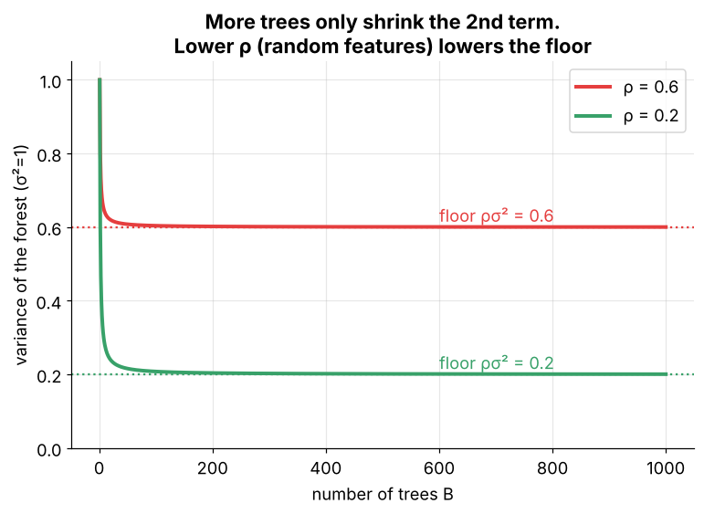

$$\mathrm{Var}(\text{forest})=\rho\sigma^2+\frac{(1-\rho)\sigma^2}{B}$$

- **More trees** make the 2nd term small but can **never remove** the first term $\rho\sigma^2$.
- **Lower ρ** (random features) lowers that floor.
- **Trade-off:** each single tree gets a bit worse (it may miss the best feature), but the **forest gets better**.

**Example:** σ² = 1, B = 500 → ρ = 0.6 gives **0.601**; ρ = 0.2 gives **0.202**.

### Random Forest in code

```python
tree = DecisionTreeClassifier(random_state=0).fit(X_tr, y_tr)
rf = RandomForestClassifier(n_estimators=300, oob_score=True,
                            random_state=0, n_jobs=-1)
rf.fit(X_tr, y_tr)
print(f"tree test accuracy:   {tree.score(X_te, y_te):.3f}")
print(f"forest test accuracy: {rf.score(X_te, y_te):.3f}")
print(f"forest OOB accuracy: {rf.oob_score_:.3f}")
print("features tried per split:", rf.estimators_[0].max_features_)
```

```
tree test accuracy:   0.937
forest test accuracy: 0.958
forest OOB accuracy:  0.958
features tried per split: 5
```

`n_jobs=-1` uses all CPU cores. The OOB score is very close to the test score.

### How many trees?

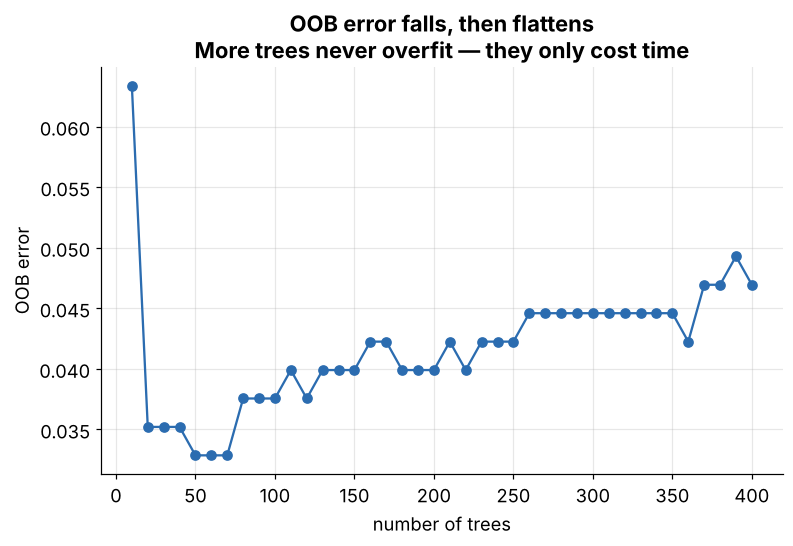

- `warm_start=True` **adds** trees and keeps the old ones.
- The OOB error falls, then flattens.
- **More trees never overfit** — they only cost time.

### Random Forest settings (in order of importance)

| Parameter | Meaning | Typical values |
|---|---|---|
| `n_estimators` | Number of trees | 200 to 1000 |
| `max_features` | Features tried per split | `"sqrt"`, 0.3 to 0.5 |
| `max_depth` | Limit tree depth | `None` (full trees) |
| `min_samples_leaf` | Smallest leaf size | 1 to 5 |
| `oob_score`, `n_jobs` | Free validation, parallel cores | `True`, `-1` |

Random forests work well with **default settings** — a great first model for tabular data.

---

## 9. Feature Importance

**Which features does the forest rely on?**

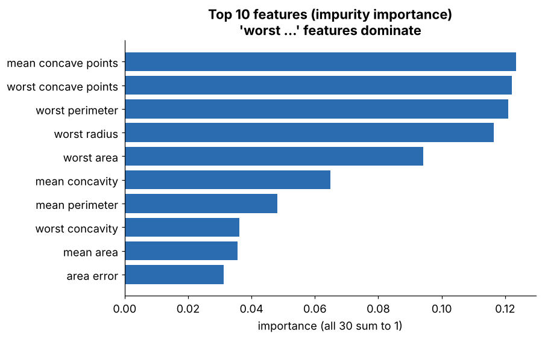

| Type | How it works | Notes |
|---|---|---|
| **Impurity importance** (`feature_importances_`) | Sum of the impurity decreases a feature produces over all splits and trees | **Biased:** favors features with many possible split points, and is measured on **training** data |
| **Permutation importance** (`sklearn.inspection.permutation_importance`) | Shuffle one feature on **test** data and measure how much the score drops | **More reliable** |

**Correlated features:** two correlated features **share** the importance, so each can look less important than it is.

```python
rf = RandomForestClassifier(n_estimators=300, random_state=0)
rf.fit(X_tr, y_tr)
imp = pd.Series(rf.feature_importances_, index=names)
imp.sort_values().tail(10).plot(kind="barh")
```

All 30 importances sum to 1; on breast cancer the **"worst …"** features dominate.

---

## 10. AdaBoost

**Boosting idea:** learn from the mistakes, one model at a time.

- **Sequential:** train a model, look at what it gets wrong, train the next one to fix exactly that.
- **Weak learners:** each model is small — a **stump** (a tree with one split) or a tree of depth 2–6.
- **Add them up:** the final model is a **weighted sum** of the small models.
- **Reduces bias:** many simple models added together can represent a very complex function.

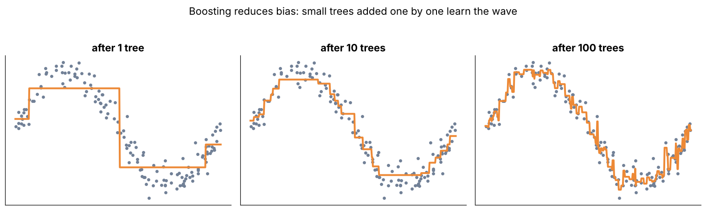

**AdaBoost = re-weight the hard examples**

1. **Start equal:** every training example gets the same weight.
2. **Train and score:** fit a stump on the weighted data and compute its weighted error ε.
3. **Model weight:** accurate stumps get a large say α; a stump near 50% error gets almost none.
4. **Re-weight:** increase the weights of misclassified examples so the next stump concentrates on them.

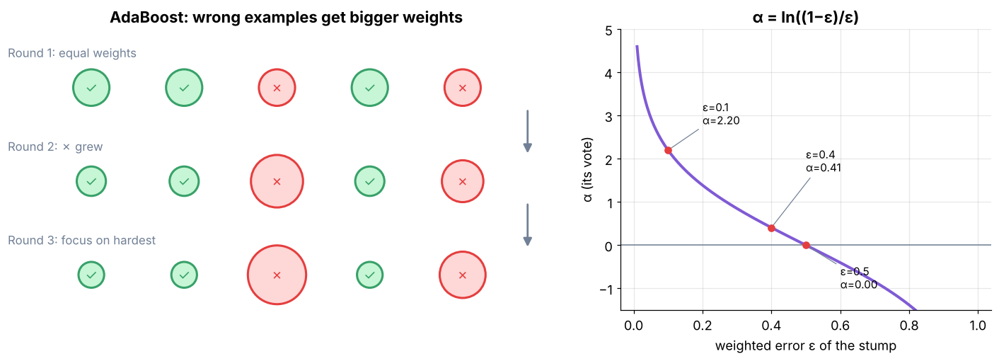

$$\alpha=\ln\frac{1-\varepsilon}{\varepsilon}, \qquad w_i \leftarrow w_i\cdot e^{\alpha}\ \text{ if wrong}$$

| Symbol | Meaning |
|---|---|
| $\varepsilon$ | weighted error of the stump |
| $\alpha$ | the stump's vote in the final sum |
| $w_i$ | weight of example $i$ (then normalized) |

**Examples:** ε = 0.1 → α = ln 9 = **2.20**; ε = 0.4 → **0.41**; ε = 0.5 → **0**.

```python
stump = DecisionTreeClassifier(max_depth=1).fit(X_tr, y_tr)
print(f"one stump: {stump.score(X_te, y_te):.3f}")
ada = AdaBoostClassifier(stump, n_estimators=200, random_state=0).fit(X_tr, y_tr)
print(f"AdaBoost: {ada.score(X_te, y_te):.3f}")
print("errors ε:", ada.estimator_errors_[:5].round(3))
print("weights α:", ada.estimator_weights_[:5].round(3))
```

```
one stump: 0.923
AdaBoost: 0.972
errors ε: [0.077 0.154 0.148 0.244 0.264]
weights α: [2.477 1.701 1.748 1.132 1.027]
```

Notice: the stump with the smallest error (0.077) gets the biggest vote (2.477).

---

## 11. Gradient Boosting

**Fit each new tree to the remaining errors.**

1. **Start simple:** begin with a constant prediction, such as the mean of y.
2. **Residuals:** compute what is still wrong, $r_i=y_i-F(x_i)$. For squared error this is exactly the **negative gradient** of the loss.
3. **Fit and add:** train a small regression tree $h$ on the residuals and add a fraction ν of it to the model.
4. **Any loss:** for other losses (log-loss for classification) the tree fits the negative gradient — hence "**gradient** boosting".

$$F_m(x)=F_{m-1}(x)+\nu\cdot h_m(x)$$

| Symbol | Meaning |
|---|---|
| $F_m$ | model after $m$ trees |
| $h_m$ | tree fitted to the residuals of $F_{m-1}$ |
| $\nu$ | learning rate (shrinkage) |

**Example:** y = 10, F = 8 → residual = 2; the tree predicts 2; with ν = 0.1 → F = **8.2**.

### Gradient boosting from scratch

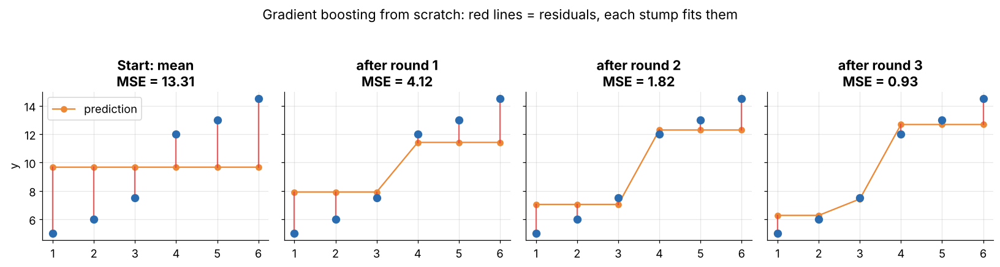

**How to read the image:** the red lines are the residuals. After each round the prediction (orange) moves closer to the data and the MSE shrinks.

```python
X = np.arange(1, 7).reshape(-1, 1)
y = np.array([5.0, 6.0, 7.5, 12.0, 13.0, 14.5])
pred = np.full(6, y.mean())          # start: the mean
lr = 0.5
for step in range(1, 5):
    res = y - pred                    # what is still wrong
    tree = DecisionTreeRegressor(max_depth=1).fit(X, res)
    pred += lr * tree.predict(X)
    mse = np.mean((y - pred) ** 2)
    print(f"round {step}: r={res.round(1)} MSE={mse:.2f}")
```

```
round 1: r=[-4.7 -3.7 -2.2  2.3  3.3  4.8] MSE=4.12
round 2: r=[-2.9 -1.9 -0.4  0.6  1.6  3.1] MSE=1.82
round 3: r=[-2.  -1.   0.5 -0.3  0.7  2.2] MSE=0.93
round 4: r=[-1.3 -0.3  0.1 -0.7  0.3  1.8] MSE=0.43
```

*(I re-ran this code and got the same numbers.)*

---

## 12. Learning Rate and Number of Trees

**Small steps, many trees.**

- **Shrinkage:** multiply each new tree by ν between 0 and 1, so no single tree can push the model too far.
- **Trade-off:** a smaller learning rate needs **more trees** but usually **generalizes better**.
- **Boosting can overfit:** unlike a random forest, adding more and more trees eventually fits the noise.
- **Early stopping:** watch a validation score and stop adding trees when it stops improving (see [section 16](#16-early-stopping)).

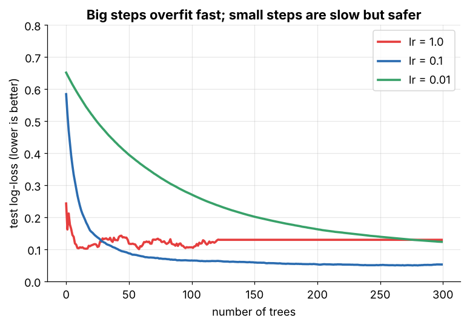

*(Test log-loss after every added tree: 300 trees of depth 2 on breast cancer, lower is better. `staged_predict_proba` gives predictions after each tree.)*

| Parameter | Typical |
|---|---|
| `learning_rate` | 0.01 to 0.3 |
| `n_estimators` | 100 to 5000 |
| `max_depth` | 2 to 6 |
| `subsample` | 0.5 to 1.0 |

`subsample < 1` trains each tree on a random part of the data (**stochastic gradient boosting**).

```python
for lr in [1.0, 0.1, 0.01]:
    gb = GradientBoostingClassifier(n_estimators=300, learning_rate=lr,
                                    max_depth=2, random_state=0)
    gb.fit(X_tr, y_tr)
    loss = [log_loss(y_te, p) for p in gb.staged_predict_proba(X_te)]
    plt.plot(loss, label=f"lr = {lr}")
plt.legend(); plt.show()
```

---

## 13. Bagging vs. Boosting

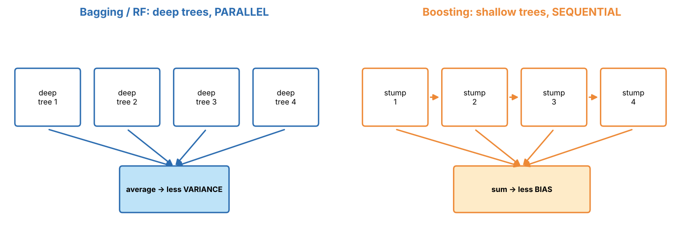

| | Bagging / Random Forest | Boosting |
|---|---|---|
| Trees | Deep, independent | Shallow, sequential |
| Reduces | Variance | Bias (and variance) |
| Training | Parallel, fast | Sequential |
| More trees | **Never overfits** | **Can overfit** → early stopping |
| Tuning | Works well by default | Needs tuning, usually wins |

> **Rule of thumb:** start with a **random forest**; move to **gradient boosting** for the last few percent.

---

## 14. Boosting at Scale: XGBoost and LightGBM

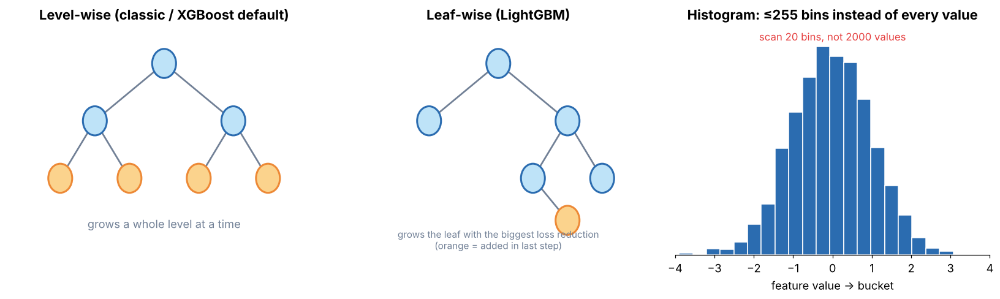

### XGBoost — *eXtreme Gradient Boosting* (Chen & Guestrin, 2016)

- **Regularized objective:** adds a penalty on the number of leaves and on the leaf values to the loss, to fight overfitting.
- **Second-order:** uses both the gradient **and the curvature (Hessian)** of the loss to compute leaf values (Newton boosting).
- **Fast and scalable:** parallel split finding, histogram mode (`tree_method="hist"`), GPU support, built-in missing-value handling.
- **Famous:** won a large share of Kaggle competitions on tabular data after 2015.

$$\mathrm{Obj}=\sum_i l(y_i,\hat y_i)+\sum_k\left(\gamma T_k+\tfrac12\lambda\lVert w_k\rVert^2\right)$$

| Symbol | Meaning |
|---|---|
| $l$ | loss, e.g. log-loss |
| $T_k$ | number of leaves in tree $k$ |
| $w_k$ | leaf values of tree $k$ |
| $\gamma,\ \lambda$ | `gamma` and `reg_lambda` |

Leaf value: $w=-\dfrac{G}{H+\lambda}$, where $G$ = sum of gradients and $H$ = sum of Hessians.

### LightGBM — *Light Gradient Boosting Machine* (Microsoft, 2017)

- **Histograms:** bins each feature into at most **255 buckets**, so finding a split means scanning bins, not every value — much faster.
- **Leaf-wise growth:** grows the leaf with the **biggest loss reduction** instead of a whole level at a time.
- **GOSS and EFB:** keeps rows with large gradients and samples the rest; bundles sparse features that are rarely non-zero together.
- **Watch `num_leaves`:** leaf-wise trees can get deep fast — limit `num_leaves` and `min_child_samples`.

### Basic usage — same fit / predict interface as scikit-learn

| Library | Model class | Key settings |
|---|---|---|
| scikit-learn | `HistGradientBoostingClassifier` | `learning_rate`, `max_leaf_nodes`, `max_iter` |
| XGBoost | `xgboost.XGBClassifier` | `n_estimators`, `learning_rate`, `max_depth`, `reg_lambda` |
| LightGBM | `lightgbm.LGBMClassifier` | `n_estimators`, `learning_rate`, `num_leaves` |
| All three | `model.fit(X_tr, y_tr)` | `model.predict(X_te)`, `predict_proba` |

```bash
pip install xgboost lightgbm
```

---

## 15. Histogram Gradient Boosting

**Classic vs. histogram-based boosting** on 50,000 rows (synthetic data, 20 features, 100 trees each).

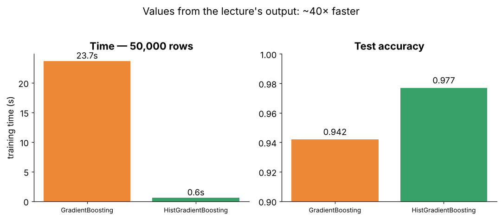

```python
from time import perf_counter
X, y = make_classification(n_samples=50_000, n_features=20,
                           n_informative=10, random_state=0)
X_tr, X_te, y_tr, y_te = train_test_split(X, y, random_state=0)
for Model in [GradientBoostingClassifier, HistGradientBoostingClassifier]:
    t0 = perf_counter()
    model = Model(random_state=0).fit(X_tr, y_tr)
    secs, acc = perf_counter() - t0, model.score(X_te, y_te)
    print(f"{Model.__name__:30} {secs:4.1f}s acc {acc:.3f}")
```

**Output (from the lecture)**

```
GradientBoostingClassifier     23.7s acc 0.942
HistGradientBoostingClassifier  0.6s acc 0.977
```

**Takeaway:** same number of trees, about **40× faster**, and (here) also more accurate — binning the features makes split search cheap.

---

## 16. Early Stopping

**Let the validation data decide the number of trees.**

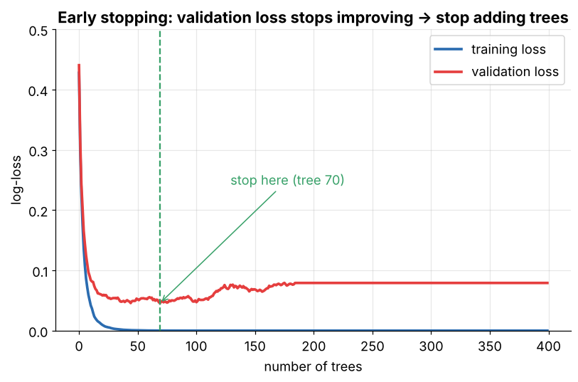

**The idea:** keep a part of the training data aside, and stop adding trees when its score has not improved for a while.

**Benefits**
- no need to tune `n_estimators`;
- prevents boosting from overfitting;
- saves training time.

| Library | How |
|---|---|
| **Histogram boosting** | `early_stopping=True, validation_fraction=0.1, n_iter_no_change=10` — **on by default above 10,000 rows**. Use a large `max_iter` and let it stop. |
| **Classic boosting** | `GradientBoostingClassifier(n_iter_no_change=10)` |
| **XGBoost / LightGBM** | pass a validation set and `early_stopping_rounds` (XGBoost) or an early-stopping callback (LightGBM) |

---

## 17. Important Equations

| # | Name | Equation | Example |
|---|---|---|---|
| 1 | Bootstrap: chance a row is picked | $1-(1-1/n)^n \to 1-1/e\approx0.632$ | n = 10 → 0.651 |
| 2 | Bagging prediction | $f_{\text{bag}}(x)=\frac1B\sum_b f_b(x)$ | B = 100 trees |
| 3 | Variance of an average | $\rho\sigma^2+\frac{(1-\rho)\sigma^2}{B}$ | ρ=0.5, B=100 → 0.505 |
| 4 | AdaBoost model weight | $\alpha=\ln\frac{1-\varepsilon}{\varepsilon}$ | ε=0.1 → 2.20 |
| 5 | AdaBoost re-weighting | $w_i\leftarrow w_i\,e^{\alpha}$ if wrong | then normalize |
| 6 | Gradient boosting update | $F_m=F_{m-1}+\nu\,h_m$ | 8 + 0.1·2 = 8.2 |
| 7 | Residual (squared error) | $r_i=y_i-F(x_i)$ | 10 − 8 = 2 |
| 8 | XGBoost objective | $\sum l(y_i,\hat y_i)+\sum_k(\gamma T_k+\frac12\lambda\lVert w_k\rVert^2)$ | regularized |
| 9 | XGBoost leaf value | $w=-G/(H+\lambda)$ | Newton step |

---

## 18. Quick Reference

### Which ensemble fixes what?

| Problem | Fix | Why |
|---|---|---|
| Overfitting (high variance) | Bagging / Random Forest | Averaging deep trees cancels noise |
| Underfitting (high bias) | Boosting | Adding shallow trees fits more complex patterns |

### Methods at a glance

| Method | Models | Training | Combine | Class |
|---|---|---|---|---|
| Voting | different types | independent | vote / average prob. | `VotingClassifier` |
| Bagging | same type, bootstrap samples | parallel | vote / average | `BaggingClassifier` |
| Random Forest | trees + random features | parallel | vote / average | `RandomForestClassifier` |
| AdaBoost | stumps | sequential | weighted vote (α) | `AdaBoostClassifier` |
| Gradient Boosting | shallow trees on residuals | sequential | sum × ν | `GradientBoostingClassifier` |
| Stacking | any | independent + meta-model | meta-model | `StackingClassifier` |

### Hyper-parameter cheat sheet

| Model | Most important settings |
|---|---|
| Random Forest | `n_estimators` 200–1000, `max_features` "sqrt", `min_samples_leaf` 1–5, `oob_score=True`, `n_jobs=-1` |
| Gradient Boosting | `learning_rate` 0.01–0.3, `n_estimators` 100–5000, `max_depth` 2–6, `subsample` 0.5–1.0 |
| LightGBM | `num_leaves`, `min_child_samples`, `learning_rate` |
| XGBoost | `max_depth`, `reg_lambda`, `learning_rate` |

### Key numbers to remember

- A bootstrap sample contains **≈ 63.2%** distinct rows; **≈ 36.8%** are out-of-bag.
- Random forest classification uses **√p** features per split (30 features → 5).
- 101 independent models at 60% accuracy → majority vote **≈ 98%**.
- Random forests: more trees **never overfit**. Boosting: more trees **can overfit**.
- `HistGradientBoosting` turns on early stopping automatically above **10,000 rows**.

### Decision guide

1. **Tabular data, first model?** → Random Forest (defaults work well).
2. **Need the last few percent?** → Gradient boosting (tune learning rate, depth, trees + early stopping).
3. **Big data or need speed?** → `HistGradientBoosting`, **LightGBM** or **XGBoost**.

---

## 19. Practice Questions

<details>
<summary><b>Q1.</b> Why does a voting ensemble need models that make <i>different</i> mistakes?</summary>

If the models make the same mistakes, the majority vote repeats the same error — copies of one model add nothing. Independent errors cancel out in the vote.
</details>

<details>
<summary><b>Q2.</b> What does bagging reduce, and what does boosting reduce?</summary>

Bagging (and Random Forest) reduces **variance** by averaging deep, high-variance trees. Boosting mainly reduces **bias** by adding shallow, high-bias trees one after another.
</details>

<details>
<summary><b>Q3.</b> Why does a bootstrap sample contain only about 63.2% of the distinct rows?</summary>

A row is missed in one draw with probability (1 − 1/n). After n draws it is missed with probability (1 − 1/n)ⁿ → 1/e ≈ 0.368. So it is picked with probability 1 − 1/e ≈ 0.632.
</details>

<details>
<summary><b>Q4.</b> What is an out-of-bag score and why is it useful?</summary>

Each tree did not see about 37% of the rows. For every row, only the trees that did not see it vote; the accuracy of those votes estimates test accuracy without a separate validation set. It is useful for small datasets and quick tuning.
</details>

<details>
<summary><b>Q5.</b> What does a Random Forest add to plain bagging, and why does it help?</summary>

At every split it considers only a random subset of features (√p for classification). This lowers the correlation ρ between trees, which lowers the variance floor ρσ² of the average.
</details>

<details>
<summary><b>Q6.</b> Compute the variance of an ensemble with σ² = 1, ρ = 0.5, B = 100.</summary>

Var = ρσ² + (1 − ρ)σ²/B = 0.5 + 0.5/100 = 0.5 + 0.005 = **0.505**.
</details>

<details>
<summary><b>Q7.</b> With σ² = 1 and B = 500, compare ρ = 0.6 and ρ = 0.2.</summary>

ρ = 0.6 → 0.6 + 0.4/500 ≈ **0.601**. ρ = 0.2 → 0.2 + 0.8/500 ≈ **0.202**. Lower correlation gives a much lower variance.
</details>

<details>
<summary><b>Q8.</b> Why is permutation importance more reliable than impurity importance?</summary>

Impurity importance is measured on training data and favors features with many possible split points. Permutation importance shuffles one feature on test data and measures how much the score drops.
</details>

<details>
<summary><b>Q9.</b> An AdaBoost stump has weighted error ε = 0.1. What is its weight α? What if ε = 0.5?</summary>

α = ln((1 − 0.1)/0.1) = ln 9 ≈ **2.20**. For ε = 0.5, α = ln 1 = **0** — the stump is no better than a coin flip and gets no say.
</details>

<details>
<summary><b>Q10.</b> In gradient boosting, y = 10, the current prediction F = 8, and ν = 0.1. What is the new prediction?</summary>

Residual = 10 − 8 = 2. The tree predicts 2, so F_new = 8 + 0.1 × 2 = **8.2**.
</details>

<details>
<summary><b>Q11.</b> Why does a smaller learning rate usually generalize better, and what is the cost?</summary>

Each tree can move the model only a little, so no single tree overfits. The cost is that you need more trees (more training time).
</details>

<details>
<summary><b>Q12.</b> Can you add too many trees in a random forest? In gradient boosting?</summary>

Random forest: no — more trees never overfit, they only cost time. Gradient boosting: yes — eventually it fits the noise, so use early stopping.
</details>

<details>
<summary><b>Q13.</b> Name two ideas that make LightGBM fast, and one thing you must limit.</summary>

Histogram binning (≤ 255 buckets) and leaf-wise growth (also GOSS and EFB). Limit `num_leaves` and `min_child_samples`, because leaf-wise trees can get deep fast.
</details>

<details>
<summary><b>Q14.</b> What does XGBoost add on top of plain gradient boosting?</summary>

A regularized objective (penalty on number of leaves and leaf values), second-order (Newton) updates using the Hessian, parallel/histogram/GPU speed, and built-in missing-value handling.
</details>

<details>
<summary><b>Q15.</b> When does <code>HistGradientBoostingClassifier</code> use early stopping automatically?</summary>

When the dataset has more than 10,000 rows (`early_stopping="auto"`), with `validation_fraction=0.1` and `n_iter_no_change=10`.
</details>

---

<p align="center"><b>Thank You</b> · Presented by TriNode Team · Best Wishes</p>
